# Database Schema Design: Complete, Parts 1 and 2 (Annotated)

**Source:** Actor Response 61 (Part 1 of 2) and Actor Response 62 (Part 2 of 2), both Actor → Operator.
**Scope of this file:** the full schema design: conventions, ER diagram, decisions, all 25 tables in Groups A to I, the group summary, the constraint-enforcement summary, the requirements-to-schema mapping and the coverage confirmation.
**Layout:** sections 1 to 7 are Part 1 (Groups A and B). Sections 8 to 19 are Part 2 (Groups C to I and the summaries). Sections 20 to 23 are explanatory additions and process notes.
**Nothing is summarized:** every table definition, index, note and table from both source messages is reproduced in full. Explanations are added around the source text, and source notes are quoted word for word.

> **Status:** This is design text only. No Django models, migrations, SQL files or implementation code have been created. Django's ORM cannot express composite foreign keys natively, so any implementation needs explicit SQL migrations (recorded in the constraint-enforcement summary, section 16).

## Table of contents

**Part 1**

1. [How to read this document](#1-how-to-read-this-document)
2. [Conventions](#2-conventions)
3. [ER diagram](#3-er-diagram)
4. [Design decisions carried from the conceptual design](#4-design-decisions-carried-from-the-conceptual-design)
5. [Table inventory](#5-table-inventory)
6. [Group A: tenancy, identity, authentication](#6-group-a-tenancy-identity-authentication)
7. [Group B: patients, assignments, supervision](#7-group-b-patients-assignments-supervision)

**Part 2**

8. [Group C: consent](#8-group-c-consent)
9. [Group D: appointments](#9-group-d-appointments)
10. [Group E: clinical notes](#10-group-e-clinical-notes)
11. [Group F: treatment](#11-group-f-treatment)
12. [Group G: assessments](#12-group-g-assessments)
13. [Group H: files](#13-group-h-files)
14. [Group I: audit](#14-group-i-audit)
15. [Group summary](#15-group-summary)
16. [Constraint enforcement summary](#16-constraint-enforcement-summary)
17. [Requirements-to-schema mapping](#17-requirements-to-schema-mapping)
18. [Coverage confirmation](#18-coverage-confirmation)
19. [What this document is not](#19-what-this-document-is-not)

**Explanatory additions and process notes**

20. [Cross-cutting patterns explained](#20-cross-cutting-patterns-explained)
21. [Review notes on Part 1 and open points](#21-review-notes-on-part-1-and-open-points)
22. [Review notes on Part 2 and cross-reference crosswalk](#22-review-notes-on-part-2-and-cross-reference-crosswalk)
23. [Process notes from the source messages](#23-process-notes-from-the-source-messages)

---

## 1. How to read this document

The original message is a schema specification. This version keeps every table definition and rule from it and adds, for each table:

- **Purpose:** what the table is for in the product.
- **Column guide:** what each non-obvious column means.
- **Constraints and indexes explained:** what each rule enforces and why.
- **Design notes:** the rationale and the traps to avoid.

The schema targets **PostgreSQL**. It models a multi-tenant (multi-clinic) clinical practice system where therapists, supervisors, assistants and admins work with patient records, and where tenant isolation and auditability are central.

Terms used throughout:

| Term | Meaning |
|---|---|
| Tenant | One clinic or practice. All clinical data belongs to exactly one tenant. |
| Membership | A user's participation in a tenant, with roles. A user can have memberships in several tenants over time. |
| Active | A row whose `ended_at` (or `revoked_at`) is `NULL`. |
| Composite FK | A foreign key over `(id, tenant_id)` or `(id, patient_id, tenant_id)` so a child row cannot point to a parent in a different tenant. |

---

## 2. Conventions

These apply to every table.

| Convention | Detail |
|---|---|
| Primary keys | `UUID`, default `gen_random_uuid()`. |
| Timestamps | `TIMESTAMPTZ` (timezone-aware). |
| Business dates | `DATE`. |
| Local times | `TIME`. |
| Tenant ownership | Tenant-owned tables carry `tenant_id UUID NOT NULL`. |
| Foreign keys | All are `ON DELETE RESTRICT` and `ON UPDATE RESTRICT` unless noted. There are no cascades for clinical or audit data. |
| `updated_at` | Defaults to `now()` and is refreshed by application logic. No trigger is assumed. |

### 2.1 The composite foreign key pattern

A normal FK such as `patient_id REFERENCES patient(id)` only guarantees the patient exists. It does **not** guarantee the patient belongs to the same tenant as the child row. A bug or an attack could then link a row in tenant A to a patient in tenant B.

The schema prevents this as follows:

1. The parent table exposes a unique key that includes the tenant: `UNIQUE (id, tenant_id)` or `UNIQUE (id, patient_id, tenant_id)`.
2. The child references that whole tuple: `FOREIGN KEY (patient_id, tenant_id) REFERENCES patient (id, tenant_id)`.

Now the database itself rejects any cross-tenant link.

**Why NULL does not bypass this.** PostgreSQL uses `MATCH SIMPLE` by default: if any column of the child's FK tuple is `NULL`, the check is skipped. This is fine here for two reasons:

- A **nullable** reference column (for example `supervisor_membership_id`) being `NULL` means "no supervisor", so skipping the check is the desired behaviour.
- `tenant_id` is `NOT NULL` on tenant-owned tables, so the tenant half of the tuple can never be `NULL`. Nobody can use a `NULL` tenant to dodge the match.

### 2.2 Why RESTRICT everywhere

Cascading deletes on clinical or audit data are dangerous: one deletion could silently remove records that must be retained. `RESTRICT` forces any removal to be deliberate and explicit. The schema uses end-dating (`ended_at`, `revoked_at`, `archived_at`) instead of deletion.

---

## 3. ER diagram

Save the block below as `schema.mmd` and render it with any Mermaid renderer (mermaid.live, the VS Code Mermaid preview, GitHub, GitLab). It shows all 25 entities with relationships and cardinalities. Column-level detail is in sections 6 and 7 (Part 1) and sections 8 to 14 (Part 2).

```mermaid
erDiagram
    Tenant ||--o{ TenantMembership : "has"
    User   ||--o{ TenantMembership : "is member via"
    User   ||--o{ Session          : "authenticates via"
    User   ||--o{ ResetToken       : "recovers via"
    User   ||--o{ PlatformRole     : "platform access"
    Tenant ||--o{ Invitation       : "issues"
    TenantMembership ||--o{ Invitation : "invited by"
    TenantMembership ||--o{ MembershipGrant : "granted"

    Tenant ||--o{ Patient               : "owns"
    Patient ||--o{ ClinicalAssignment   : "assigned through"
    TenantMembership ||--o{ ClinicalAssignment : "therapist or supervisor"
    Patient ||--o{ ClinicalSupervision        : "supervised for"
    TenantMembership ||--o{ ClinicalSupervision : "supervisor / supervisee"
    TenantMembership ||--o{ SupervisoryOperationalScope : "supervisor / supervisee"

    Tenant ||--o{ ConsentTextVersion : "may define"
    Patient ||--o{ ConsentRecord     : "consents"
    ConsentTextVersion ||--o{ ConsentRecord : "governs"
    ConsentRecord ||--o{ ConsentRecord : "withdraws"
    PatientFile   ||--o{ ConsentRecord : "evidence of"

    Patient ||--o{ Appointment : "has"
    TenantMembership ||--o{ Appointment : "therapist"
    Appointment ||--o{ AppointmentHistory : "changes recorded"
    TenantMembership ||--o{ AppointmentHistory : "changed by"

    Patient ||--o{ ClinicalNoteDraft : "has"
    TenantMembership ||--o{ ClinicalNoteDraft : "author"
    Patient ||--o{ ClinicalNote : "has"
    TenantMembership ||--o{ ClinicalNote : "author"
    ClinicalNoteDraft ||--|| ClinicalNote : "finalizes to"
    ClinicalNote ||--o{ ClinicalNote : "addendum to"
    ClinicalNote ||--o{ NoteAppointmentLink : "linked via"
    Appointment ||--o{ NoteAppointmentLink : "linked via"
    TenantMembership ||--o{ NoteAppointmentLink : "created by"

    Patient ||--o{ TreatmentPlan : "has"
    TenantMembership ||--o{ TreatmentPlan : "created by"
    TreatmentPlan ||--o{ TreatmentGoal : "has"
    TreatmentGoal ||--o{ ProgressEntry : "tracked by"
    Patient ||--o{ ProgressEntry : "has"
    TenantMembership ||--o{ ProgressEntry : "recorded by"

    Patient ||--o{ AssessmentResult : "has"
    TenantMembership ||--o{ AssessmentResult : "recorded by"
    PatientFile ||--o{ AssessmentResult : "attached to"

    Patient ||--o{ PatientFile : "has"
    TenantMembership ||--o{ PatientFile : "uploaded by"

    Tenant ||--o{ AuditEvent : "scoped to"
    User   ||--o{ AuditEvent : "actor when user"
    TenantMembership ||--o{ AuditEvent : "actor membership when user"
```



### 3.1 Reading the notation

- `||--o{` means "exactly one on the left, zero or many on the right". For example, one Tenant has zero or more TenantMemberships.
- `||--||` (ClinicalNoteDraft to ClinicalNote) means one-to-one.
- A self-relationship (`ClinicalNote ||--o{ ClinicalNote`, `ConsentRecord ||--o{ ConsentRecord`) means the table references itself, used for addenda and withdrawals.

### 3.2 Cardinality rules the diagram cannot show

These live in SQL constraints rather than in the diagram:

- A patient has **exactly one active primary ClinicalAssignment** at a time (partial unique index).
- A ClinicalNote has **exactly one source ClinicalNoteDraft** (unique FK) and **zero or more addendum notes** that reference it (self-FK).
- ConsentRecords form **chains**: each withdrawal has exactly one parent grant, and each grant has at most one withdrawal.
- `AuditEvent.tenant_id` is `NULL` only for platform-scoped events. A CHECK (`ck_ae_tenant_for_clinical_resources`, defined in Part 2, Group I, section 14.1 of this file) enforces that any event with a tenant-owned `resource_type` has a tenant.

---

## 4. Design decisions carried from the conceptual design

The decisions below come from Actor Response 60 and drive the schema. They are repeated here so this document stands on its own.

| ID | Decision | Effect on the schema |
|---|---|---|
| D1 | Patient identity is clinic-scoped. | `patient` is tenant-owned. The same real person at two clinics is two patient rows. |
| D2 | An incoming therapist sees all finalized notes for the patient. | Access rule (application/predicate layer), based on active `clinical_assignment`. |
| D3 | An outgoing therapist sees authored notes only through the authored-records view, revoked when membership ends. | Access rule tied to `tenant_membership.ended_at`. |
| D4 | The authored-records view is available to any therapist for their own notes, with no co-authorization. | Access rule. |
| D5 | The authored-records view shows minimum identifying information. | View/query design. |
| D6 | A no-show occupies the slot until an explicit, audited release. The exclusion predicate is `status <> 'cancelled'`. | Appointment overlap constraint (section 9.1). |
| D7 | Addenda use `addendum_to_note_id` with a required reason. No supersession in the MVP. | ClinicalNote self-FK (section 10.2). |
| D8 | Consent text versions are tenant-optional. `NULL` tenant_id means platform-provided. | ConsentTextVersion (section 8.1). |
| D9 | ClinicalSupervision is patient-specific. SupervisoryOperationalScope is operational only. | Tables 7.3 and 7.4 below. |
| D10 | Break-glass access is deferred. | No break-glass tables. |
| D11 | Audit failure policy: fail closed. Audited reads also deny when the audit write fails. | Application behaviour. |
| D12 | Privileged-actor risk is accepted. Runtime-role restrictions apply. | Database role design. |
| D13 | Erasure of finalized note text is not supported in the MVP. | No erase path for notes. |
| D14 | Cross-clinic double-booking is allowed, with a documented limitation. | Overlap constraints are tenant-scoped. |
| D15 | Audit retention is provisionally 7 years. Hosting is undecided. | Audit retention policy. |
| D16 | File deletion is soft delete with lifecycle states. A purge process is deferred. | PatientFile (section 13.1). |

### 4.1 One technical resolution not in the conceptual design

`ClinicalNote.appointment_id` was **dropped** in favour of `NoteAppointmentLink` as the only note-to-appointment relationship.

**Why:** a finalized note is immutable. A column on the note could not be updated after finalization, so a late-discovered link to an appointment would be impossible. A separate link table can be added to later (with append-only history) without touching the immutable note. This is consistent with the intent of decision D-N1.

---

## 5. Table inventory

**25 tables in 9 groups.**

| Group | Name | Count | Tables |
|---|---|---|---|
| A | Tenancy, identity, authentication | 8 | Tenant, User, TenantMembership, MembershipGrant, Session, ResetToken, Invitation, PlatformRole |
| B | Patients, assignments, supervision | 4 | Patient, ClinicalAssignment, ClinicalSupervision, SupervisoryOperationalScope |
| C | Consent | 2 | ConsentTextVersion, ConsentRecord |
| D | Appointments | 2 | Appointment, AppointmentHistory |
| E | Clinical notes | 3 | ClinicalNoteDraft, ClinicalNote, NoteAppointmentLink |
| F | Treatment | 3 | TreatmentPlan, TreatmentGoal, ProgressEntry |
| G | Assessments | 1 | AssessmentResult |
| H | Files | 1 | PatientFile |
| I | Audit | 1 | AuditEvent |

**Part 1 covers Groups A and B (12 tables). Part 2 covers Groups C to I (13 tables) and the summaries.**

---

## 6. Group A: tenancy, identity, authentication

### 6.1 Tenant

**Purpose:** one row per clinic or practice. It is the root of data isolation.

```sql
CREATE TABLE tenant (
    id           UUID PRIMARY KEY DEFAULT gen_random_uuid(),
    name         TEXT NOT NULL,
    slug         TEXT NOT NULL,
    timezone     TEXT NOT NULL,
    status       TEXT NOT NULL DEFAULT 'active'
                 CHECK (status IN ('active','suspended','closed')),
    created_at   TIMESTAMPTZ NOT NULL DEFAULT now(),
    updated_at   TIMESTAMPTZ NOT NULL DEFAULT now(),
    archived_at  TIMESTAMPTZ,
    CONSTRAINT uq_tenant_slug UNIQUE (slug),
    CONSTRAINT ck_tenant_archived CHECK (
        (status = 'closed' AND archived_at IS NOT NULL)
        OR status <> 'closed'
    )
);
```

**Column guide**

| Column | Meaning |
|---|---|
| `name` | Display name of the clinic. |
| `slug` | URL-safe identifier, unique across the whole platform. |
| `timezone` | IANA timezone identifier (for example `Asia/Tehran`). Used to interpret local appointment times. |
| `status` | `active`, `suspended` or `closed`. |
| `archived_at` | When the tenant was closed. |

**Constraints explained**

- `uq_tenant_slug`: two clinics cannot share a URL slug.
- `ck_tenant_archived`: a `closed` tenant must have `archived_at` set. Other statuses are unconstrained. The check is one-directional: it does not forbid `archived_at` on an active tenant.

**Design notes:** tenants are never deleted. Closing a tenant is a status change plus a timestamp.

---

### 6.2 User (table `app_user`)

**Purpose:** one row per human account, independent of any clinic. A person who works at two clinics is one user with two memberships.

```sql
CREATE TABLE app_user (
    id              UUID PRIMARY KEY DEFAULT gen_random_uuid(),
    email           TEXT NOT NULL,
    email_norm      TEXT NOT NULL,
    password_hash   TEXT NOT NULL,
    full_name       TEXT NOT NULL,
    is_active       BOOLEAN NOT NULL DEFAULT TRUE,
    deactivated_at  TIMESTAMPTZ,
    created_at      TIMESTAMPTZ NOT NULL DEFAULT now(),
    updated_at      TIMESTAMPTZ NOT NULL DEFAULT now(),
    CONSTRAINT uq_user_email_norm UNIQUE (email_norm),
    CONSTRAINT ck_user_active_consistent CHECK (
        (is_active = FALSE AND deactivated_at IS NOT NULL)
        OR is_active = TRUE
    )
);
CREATE INDEX ix_user_email_norm ON app_user (email_norm);
```

**Column guide**

| Column | Meaning |
|---|---|
| `email` | The email as the user typed it. |
| `email_norm` | The normalized form used for uniqueness and lookup. Persian/Arabic characters and digits are folded to a single canonical form. |
| `password_hash` | A hash only. Plaintext passwords are never stored. |
| `is_active` / `deactivated_at` | Soft deactivation. |

**Constraints explained**

- `uq_user_email_norm`: uniqueness is on the **normalized** column. Without this, visually identical emails written with different Persian/Arabic character variants could create duplicate accounts.
- `ck_user_active_consistent`: an inactive user must have a deactivation timestamp.

**Design notes**

- The table is called `app_user` because `user` is a reserved keyword in PostgreSQL.
- The normalization rule is an **implementation requirement** (Section 11 in Part 2 of the source; the normalization requirement is listed in section 16.3 of this file). The database stores the result but does not compute it.
- `ix_user_email_norm` duplicates the index that the `UNIQUE` constraint already creates (see [section 21](#21-review-notes-on-part-1-and-open-points)).

---

### 6.3 TenantMembership

**Purpose:** connects a user to a tenant and carries the user's roles there. Almost every tenant-owned table points at this table to say "who".

```sql
CREATE TABLE tenant_membership (
    id          UUID PRIMARY KEY DEFAULT gen_random_uuid(),
    tenant_id   UUID NOT NULL REFERENCES tenant(id) ON DELETE RESTRICT,
    user_id     UUID NOT NULL REFERENCES app_user(id) ON DELETE RESTRICT,
    roles       TEXT[] NOT NULL
                CHECK (roles <@ ARRAY['owner_admin','clinical_supervisor','therapist','assistant']::TEXT[])
                CHECK (array_length(roles, 1) >= 1),
    joined_at   TIMESTAMPTZ NOT NULL DEFAULT now(),
    ended_at    TIMESTAMPTZ,
    CONSTRAINT uq_tm_id_tenant    UNIQUE (id, tenant_id),
    CONSTRAINT ck_tm_dates        CHECK (ended_at IS NULL OR ended_at >= joined_at)
);
CREATE UNIQUE INDEX uq_tm_active_user
    ON tenant_membership (tenant_id, user_id)
    WHERE ended_at IS NULL;
CREATE INDEX ix_tm_user_active
    ON tenant_membership (user_id)
    WHERE ended_at IS NULL;
```

**Column guide**

| Column | Meaning |
|---|---|
| `roles` | Array of role codes: `owner_admin`, `clinical_supervisor`, `therapist`, `assistant`. |
| `joined_at` / `ended_at` | Membership period. `ended_at IS NULL` means currently active. |

**Constraints and indexes explained**

- `roles <@ ARRAY[...]`: the `<@` operator means "is contained by". Every element of `roles` must be one of the four known codes.
- `array_length(roles, 1) >= 1`: at least one role is required. An empty array would produce `NULL` from `array_length`, and a CHECK that evaluates to `NULL` passes, so the empty-array case needs care in implementation (see [section 21](#21-review-notes-on-part-1-and-open-points)).
- `ck_tm_dates`: the end cannot precede the start.
- `uq_tm_active_user` (partial unique): a user can have only **one active** membership per tenant. Past, ended memberships are unrestricted, so a person can leave and later rejoin.
- `ix_tm_user_active` (partial index): speeds up "which tenants is this user currently in?".
- `uq_tm_id_tenant`: the key that child tables use for composite FKs.

**Design notes**

- `roles` is an array so a solo practitioner can be `owner_admin` and `therapist` at once (resolves requirement X-2).
- Ending a membership is how a person's access is revoked. The row is never deleted because notes, appointments and audit events reference it.

---

### 6.4 MembershipGrant

**Purpose:** extra, narrowly-scoped permissions that sit on top of a role. Implements the "if granted" and "explicit permission" wording of features.md 6.2 (X-3).

```sql
CREATE TABLE membership_grant (
    id            UUID PRIMARY KEY DEFAULT gen_random_uuid(),
    tenant_id     UUID NOT NULL,
    membership_id UUID NOT NULL,
    grant_code    TEXT NOT NULL
                  CHECK (grant_code IN (
                      'receptionist_operational_access',
                      'security_metadata_review'
                  )),
    granted_at    TIMESTAMPTZ NOT NULL DEFAULT now(),
    revoked_at    TIMESTAMPTZ,
    CONSTRAINT fk_mg_membership
        FOREIGN KEY (membership_id, tenant_id)
        REFERENCES tenant_membership (id, tenant_id) ON DELETE RESTRICT,
    CONSTRAINT uq_mg_id_tenant UNIQUE (id, tenant_id)
);
CREATE UNIQUE INDEX uq_mg_active
    ON membership_grant (tenant_id, membership_id, grant_code)
    WHERE revoked_at IS NULL;
```

**Grant codes**

| Code | Meaning |
|---|---|
| `receptionist_operational_access` | Lets a member do front-desk operational work (scheduling, demographics) without clinical access. |
| `security_metadata_review` | Lets a member review security/audit metadata. |

**Constraints explained**

- `fk_mg_membership`: composite FK, so a grant can only attach to a membership of the **same tenant**.
- `uq_mg_active` (partial unique): the same grant cannot be active twice for the same member. After revocation, it can be granted again as a new row, which preserves history.

**Design notes:** `grant_code` is intentionally a short, closed list. Adding a new code requires a schema change (altering the CHECK), not just a data change, so each new kind of power is a deliberate, reviewable event.

---

### 6.5 Session

**Purpose:** one row per login session. Allows server-side revocation.

```sql
CREATE TABLE session (
    id                UUID PRIMARY KEY DEFAULT gen_random_uuid(),
    user_id           UUID NOT NULL REFERENCES app_user(id) ON DELETE RESTRICT,
    tenant_context_id UUID REFERENCES tenant(id) ON DELETE RESTRICT,
    issued_at         TIMESTAMPTZ NOT NULL DEFAULT now(),
    expires_at        TIMESTAMPTZ NOT NULL,
    revoked_at        TIMESTAMPTZ,
    revocation_reason TEXT,
    CONSTRAINT ck_session_dates CHECK (expires_at > issued_at)
);
CREATE INDEX ix_session_user_active
    ON session (user_id, expires_at)
    WHERE revoked_at IS NULL;
```

**Column guide**

| Column | Meaning |
|---|---|
| `tenant_context_id` | The tenant the user is currently working in. Nullable because a session exists before the user picks a tenant. |
| `expires_at` | Hard expiry. |
| `revoked_at` / `revocation_reason` | Set when the session is ended early, for example on user deactivation. |

**Design notes**

- On every request, the access predicate checks `revoked_at IS NULL AND expires_at > now()` (requirement X-5).
- Revoking on deactivation is a plain `UPDATE` of `revoked_at`.
- `tenant_context_id` references `tenant` alone (not `tenant_membership`), so the schema does not itself guarantee that the user holds a membership in that tenant. The access predicate must check this on each request.

---

### 6.6 ResetToken

**Purpose:** single-use password-reset tokens.

```sql
CREATE TABLE reset_token (
    id           UUID PRIMARY KEY DEFAULT gen_random_uuid(),
    user_id      UUID NOT NULL REFERENCES app_user(id) ON DELETE RESTRICT,
    token_hash   BYTEA NOT NULL,
    issued_at    TIMESTAMPTZ NOT NULL DEFAULT now(),
    expires_at   TIMESTAMPTZ NOT NULL,
    consumed_at  TIMESTAMPTZ,
    CONSTRAINT uq_reset_token_hash UNIQUE (token_hash),
    CONSTRAINT ck_reset_dates CHECK (expires_at > issued_at)
);
```

**Design notes**

- `token_hash` is a **hash** of the token. The raw token is emailed to the user and never stored, so a database leak does not yield usable reset links.
- `consumed_at` marks the token as used. A token is valid only while `consumed_at IS NULL` and `expires_at > now()`.
- `uq_reset_token_hash` guarantees lookup by hash is unambiguous.

---

### 6.7 Invitation

**Purpose:** a pending offer for someone to join a tenant with a set of roles. Implements X-7.

```sql
CREATE TABLE invitation (
    id                      UUID PRIMARY KEY DEFAULT gen_random_uuid(),
    tenant_id               UUID NOT NULL REFERENCES tenant(id) ON DELETE RESTRICT,
    invited_email           TEXT NOT NULL,
    invited_email_norm      TEXT NOT NULL,
    role_set                TEXT[] NOT NULL
                            CHECK (role_set <@ ARRAY['owner_admin','clinical_supervisor','therapist','assistant']::TEXT[]),
    invited_by_membership_id UUID NOT NULL,
    issued_at               TIMESTAMPTZ NOT NULL DEFAULT now(),
    expires_at              TIMESTAMPTZ NOT NULL,
    accepted_at             TIMESTAMPTZ,
    revoked_at              TIMESTAMPTZ,
    CONSTRAINT fk_inv_inviter
        FOREIGN KEY (invited_by_membership_id, tenant_id)
        REFERENCES tenant_membership (id, tenant_id) ON DELETE RESTRICT,
    CONSTRAINT ck_inv_dates CHECK (expires_at > issued_at),
    CONSTRAINT ck_inv_state CHECK (
        NOT (accepted_at IS NOT NULL AND revoked_at IS NOT NULL)
    )
);
CREATE INDEX ix_inv_tenant_open
    ON invitation (tenant_id, invited_email_norm)
    WHERE accepted_at IS NULL AND revoked_at IS NULL;
```

**Constraints explained**

- `fk_inv_inviter`: the inviter must be a member of the same tenant.
- `ck_inv_state`: an invitation cannot be both accepted and revoked.
- `ix_inv_tenant_open`: finds still-open invitations for an email within a tenant.

**Design notes**

- **No email enumeration.** Responses to invitation attempts must not reveal whether `invited_email_norm` already exists in `app_user`. The schema cannot enforce this because the query itself is what would leak. It is an **application** rule.
- Accepting an invitation creates a `tenant_membership` and sets `accepted_at`. Those two writes should happen in one transaction.
- Unlike `role_set`'s CHECK, there is no minimum-length rule here, so an invitation with an empty role set is not rejected by the schema (see [section 21](#21-review-notes-on-part-1-and-open-points)).

---

### 6.8 PlatformRole

**Purpose:** platform-level staff roles that sit outside any tenant. Implements X-8.

```sql
CREATE TABLE platform_role (
    id           UUID PRIMARY KEY DEFAULT gen_random_uuid(),
    user_id      UUID NOT NULL REFERENCES app_user(id) ON DELETE RESTRICT,
    role         TEXT NOT NULL
                 CHECK (role IN ('platform_admin','platform_auditor')),
    granted_at   TIMESTAMPTZ NOT NULL DEFAULT now(),
    revoked_at   TIMESTAMPTZ,
    CONSTRAINT ck_platform_role_no_membership CHECK (TRUE)
);
CREATE UNIQUE INDEX uq_platform_role_active
    ON platform_role (user_id, role)
    WHERE revoked_at IS NULL;
```

**Design notes**

- Platform roles **never** grant clinical access. The access predicate rejects platform-only sessions from clinical endpoints.
- `CHECK (TRUE)` does nothing. The original text says it is "a placeholder to make the intent visible; the real enforcement is the access predicate". It adds no protection and could be removed or replaced with a comment (see [section 21](#21-review-notes-on-part-1-and-open-points)).
- `uq_platform_role_active` prevents the same active role being granted twice to the same user.

---

## 7. Group B: patients, assignments, supervision

### 7.1 Patient

**Purpose:** the person receiving care at one clinic. Clinic-scoped identity (D1).

```sql
CREATE TABLE patient (
    id                    UUID PRIMARY KEY DEFAULT gen_random_uuid(),
    tenant_id             UUID NOT NULL REFERENCES tenant(id) ON DELETE RESTRICT,
    first_name            TEXT NOT NULL,
    last_name             TEXT NOT NULL,
    normalized_first_name TEXT NOT NULL,
    normalized_last_name  TEXT NOT NULL,
    dob                   DATE,
    contact_phone_enc     BYTEA,
    contact_email_enc     BYTEA,
    contact_address_enc   BYTEA,
    emergency_contact_enc BYTEA,
    intake_data           JSONB NOT NULL DEFAULT '{}'::JSONB,
    status                TEXT NOT NULL DEFAULT 'active'
                          CHECK (status IN ('active','archived')),
    created_at            TIMESTAMPTZ NOT NULL DEFAULT now(),
    updated_at            TIMESTAMPTZ NOT NULL DEFAULT now(),
    archived_at           TIMESTAMPTZ,
    CONSTRAINT uq_patient_id_tenant UNIQUE (id, tenant_id),
    CONSTRAINT ck_patient_archived CHECK (
        (status = 'archived' AND archived_at IS NOT NULL)
        OR status = 'active'
    ),
    CONSTRAINT ck_patient_intake_version CHECK (intake_data ? 'schema_version')
);
CREATE INDEX ix_patient_tenant_status
    ON patient (tenant_id, status);
CREATE INDEX ix_patient_tenant_name
    ON patient (tenant_id, normalized_last_name, normalized_first_name)
    WHERE status = 'active';
```

**Column guide**

| Column | Meaning |
|---|---|
| `first_name`, `last_name` | Names as entered (display). |
| `normalized_first_name`, `normalized_last_name` | Folded forms used for searching (A-4). |
| `dob` | Date of birth, optional. |
| `contact_*_enc`, `emergency_contact_enc` | Application-encrypted values stored as `BYTEA`. |
| `intake_data` | Structured intake answers as JSONB, carrying a `schema_version` key. |
| `status` / `archived_at` | Active or archived. |

**Constraints and indexes explained**

- `uq_patient_id_tenant`: lets every patient-related child table use a composite FK.
- `ck_patient_archived`: archived patients must have a timestamp.
- `ck_patient_intake_version`: `intake_data ? 'schema_version'` uses the JSONB `?` operator ("has this top-level key"). Every intake document must declare its version, so a later change in intake structure can be detected and migrated.
- `ix_patient_tenant_status`: lists a tenant's patients by status.
- `ix_patient_tenant_name`: partial index over active patients for name lookups.

**Design notes**

- **Persian search.** Plain B-tree indexes on raw names do not support folded matching, which is why the `normalized_*` columns exist. A plain B-tree on those columns supports exact and prefix matches on the folded form, not fuzzy or substring matching.
- **Encryption.** Contact and emergency fields are stored as `BYTEA` ciphertext so plaintext never reaches the DBMS. Key management is out of scope for this schema. Consequence: these columns cannot be searched or indexed by value.
- **No `primary_therapist_id`.** The current primary therapist is derived from `clinical_assignment`, so there is no second place that could disagree.
- Names (`first_name`, `last_name`, `dob`) are **not** encrypted at column level in this design, a deliberate trade-off to keep search practical.

---

### 7.2 ClinicalAssignment

**Purpose:** records which therapist (and optional supervisor) is responsible for a patient, in which role, and for what period. Implements D-N5, D-N8 and X-1.

```sql
CREATE TABLE clinical_assignment (
    id                      UUID PRIMARY KEY DEFAULT gen_random_uuid(),
    tenant_id               UUID NOT NULL,
    patient_id              UUID NOT NULL,
    therapist_membership_id UUID NOT NULL,
    role_in_case            TEXT NOT NULL
                            CHECK (role_in_case IN ('primary','co_therapist','observing')),
    supervisor_membership_id UUID,
    started_at              TIMESTAMPTZ NOT NULL DEFAULT now(),
    ended_at                TIMESTAMPTZ,
    CONSTRAINT fk_ca_patient
        FOREIGN KEY (patient_id, tenant_id)
        REFERENCES patient (id, tenant_id) ON DELETE RESTRICT,
    CONSTRAINT fk_ca_therapist
        FOREIGN KEY (therapist_membership_id, tenant_id)
        REFERENCES tenant_membership (id, tenant_id) ON DELETE RESTRICT,
    CONSTRAINT fk_ca_supervisor
        FOREIGN KEY (supervisor_membership_id, tenant_id)
        REFERENCES tenant_membership (id, tenant_id) ON DELETE RESTRICT,
    CONSTRAINT ck_ca_dates CHECK (ended_at IS NULL OR ended_at >= started_at),
    CONSTRAINT uq_ca_id_patient_tenant UNIQUE (id, patient_id, tenant_id)
);
CREATE UNIQUE INDEX uq_ca_one_active_primary
    ON clinical_assignment (patient_id)
    WHERE role_in_case = 'primary' AND ended_at IS NULL;
CREATE UNIQUE INDEX uq_ca_active_pair
    ON clinical_assignment (patient_id, therapist_membership_id)
    WHERE ended_at IS NULL;
CREATE INDEX ix_ca_therapist_active
    ON clinical_assignment (therapist_membership_id, ended_at);
CREATE INDEX ix_ca_supervisor_active
    ON clinical_assignment (supervisor_membership_id, ended_at)
    WHERE supervisor_membership_id IS NOT NULL;
```

**Role values**

| `role_in_case` | Meaning |
|---|---|
| `primary` | The lead therapist. Exactly one may be active per patient. |
| `co_therapist` | Shares treatment. |
| `observing` | Observer/trainee. |

**Constraints and indexes explained**

- Three composite FKs ensure the patient, the therapist and the supervisor all belong to the same tenant as the assignment.
- `uq_ca_one_active_primary`: **at most one active primary** per patient. Because the index is partial (`role_in_case = 'primary' AND ended_at IS NULL`), historical primaries are unrestricted. Note that it enforces "at most one", while the ER notes say "exactly one". The "at least one" half is not enforced by the schema.
- `uq_ca_active_pair`: the same therapist cannot hold two active assignments on one patient.
- `ix_ca_therapist_active`, `ix_ca_supervisor_active`: speed up "which patients does this therapist or supervisor have?".
- `uq_ca_id_patient_tenant`: reserved for future composite FKs. **No table currently references it** (a note-to-assignment link could use it later).

**Design notes**

- When `supervisor_membership_id` is `NULL`, `MATCH SIMPLE` skips the supervisor FK. That is correct.
- **Insert-only, with one allowed update.** Rows are never edited; the only permitted mutation is setting `ended_at` once. Enforcing "once" requires a trigger (Section 12 in Part 2 of the source; the trigger is `enforce_assignment_ended_once`, section 16.2 of this file).
- **Reassignment** is done by ending the old row and inserting a new one, which preserves the history that decisions D2 and D3 rely on.
- Nothing in the schema checks that the assigned therapist actually holds the `therapist` role in `tenant_membership.roles`. That is an application rule.

---

### 7.3 ClinicalSupervision

**Purpose:** gives a supervisor clinical access to **one specific patient** supervised through a specific therapist (D9, X-4 part 1).

```sql
CREATE TABLE clinical_supervision (
    id                       UUID PRIMARY KEY DEFAULT gen_random_uuid(),
    tenant_id                UUID NOT NULL,
    supervisor_membership_id UUID NOT NULL,
    patient_id               UUID NOT NULL,
    therapist_membership_id  UUID NOT NULL,
    started_at               TIMESTAMPTZ NOT NULL DEFAULT now(),
    ended_at                 TIMESTAMPTZ,
    CONSTRAINT fk_cs_supervisor
        FOREIGN KEY (supervisor_membership_id, tenant_id)
        REFERENCES tenant_membership (id, tenant_id) ON DELETE RESTRICT,
    CONSTRAINT fk_cs_therapist
        FOREIGN KEY (therapist_membership_id, tenant_id)
        REFERENCES tenant_membership (id, tenant_id) ON DELETE RESTRICT,
    CONSTRAINT fk_cs_patient
        FOREIGN KEY (patient_id, tenant_id)
        REFERENCES patient (id, tenant_id) ON DELETE RESTRICT,
    CONSTRAINT ck_cs_dates CHECK (ended_at IS NULL OR ended_at >= started_at),
    CONSTRAINT uq_cs_id_tenant UNIQUE (id, tenant_id)
);
CREATE UNIQUE INDEX uq_cs_active_pair
    ON clinical_supervision (supervisor_membership_id, patient_id)
    WHERE ended_at IS NULL;
CREATE INDEX ix_cs_patient_active
    ON clinical_supervision (patient_id, ended_at);
```

**Design notes**

- `patient_id` is `NOT NULL`: a supervisor reaches clinical content only for specific patients, never for "all patients of a therapist".
- All three composite FKs force supervisor, therapist and patient into the same tenant.
- `uq_cs_active_pair`: a supervisor has at most one active supervision per patient.
- The schema does not check that `therapist_membership_id` is actually assigned to the patient or that the supervisor is not the same person as the therapist. There is no self-check here, unlike in 7.4.

---

### 7.4 SupervisoryOperationalScope

**Purpose:** gives a supervisor **operational** oversight (demographics, appointments) over a supervisee's patients, without clinical access (D9, X-4 part 2).

```sql
CREATE TABLE supervisory_operational_scope (
    id                       UUID PRIMARY KEY DEFAULT gen_random_uuid(),
    tenant_id                UUID NOT NULL,
    supervisor_membership_id UUID NOT NULL,
    supervisee_membership_id UUID NOT NULL,
    started_at               TIMESTAMPTZ NOT NULL DEFAULT now(),
    ended_at                 TIMESTAMPTZ,
    CONSTRAINT fk_sos_supervisor
        FOREIGN KEY (supervisor_membership_id, tenant_id)
        REFERENCES tenant_membership (id, tenant_id) ON DELETE RESTRICT,
    CONSTRAINT fk_sos_supervisee
        FOREIGN KEY (supervisee_membership_id, tenant_id)
        REFERENCES tenant_membership (id, tenant_id) ON DELETE RESTRICT,
    CONSTRAINT ck_sos_no_self CHECK (supervisor_membership_id <> supervisee_membership_id),
    CONSTRAINT ck_sos_dates CHECK (ended_at IS NULL OR ended_at >= started_at),
    CONSTRAINT uq_sos_id_tenant UNIQUE (id, tenant_id)
);
CREATE UNIQUE INDEX uq_sos_active_pair
    ON supervisory_operational_scope (supervisor_membership_id, supervisee_membership_id)
    WHERE ended_at IS NULL;
```

**Design notes**

- It is tied to a **person** (the supervisee), not to a patient.
- The line between "operational" and "clinical" lives in the **access predicate**, not the schema. The tables only record the relationships.
- `ck_sos_no_self` prevents someone supervising themselves.
- `uq_sos_active_pair` prevents duplicate active relationships.

**ClinicalSupervision vs SupervisoryOperationalScope**

| | ClinicalSupervision | SupervisoryOperationalScope |
|---|---|---|
| Granularity | One patient | One supervisee (all their patients) |
| Access type | Clinical content | Operational data only |
| Key columns | supervisor, patient, therapist | supervisor, supervisee |
| Self-check | No | Yes |

---

---

# PART 2 OF 2

**Source:** Actor Response 62 (Actor → Operator).

This part completes the 25 tables started in Part 1 (Groups C to I), and provides the constraint-enforcement summary, the requirements-to-schema mapping and the coverage confirmation.

**Source limitation (unchanged), as stated in the source:** derived from features.md as pasted in this conversation, and from the decisions in Actor Response 60 (final conceptual design). No files, models, migrations, SQL, or implementation code have been created. The SQL below is design specification, not applied DDL.

**Conventions carried from Part 1, as stated in the source:** UUID primary keys with `gen_random_uuid()`; `TIMESTAMPTZ` for instants; `tenant_id UUID NOT NULL` on tenant-owned tables; composite FK pattern with `UNIQUE (id, tenant_id)` or `UNIQUE (id, patient_id, tenant_id)` on parents; `ON DELETE RESTRICT` and `ON UPDATE RESTRICT` throughout; `MATCH SIMPLE` (nullable FK columns skip the check, safe because `tenant_id` is `NOT NULL`).

> **Numbering note for this combined file.** The source Part 2 numbered its sections 6 to 17, which collided with the numbering of Part 1. In this combined file the sections are renumbered so they continue from Part 1 (Group C is section 8, and so on). The source text is kept word for word; where the source refers to one of its own section numbers, section 22.2 gives the exact location in this file.

> **Reading order for implementation.** `consent_record` (section 8.2) and `assessment_result` (section 12.1) reference `patient_file` (section 13.1), so in real DDL `patient_file` must be created first, or those constraints must be added afterwards with `ALTER TABLE`. See section 22.1.

---

## 8. Group C: consent

### 8.1 ConsentTextVersion

**Purpose:** the versioned wording of a consent form. A consent record points at the exact text the patient agreed to. Texts can be provided by the platform for every clinic, or written by a single clinic (decision D8).

```sql
CREATE TABLE consent_text_version (
    id             UUID PRIMARY KEY DEFAULT gen_random_uuid(),
    tenant_id      UUID REFERENCES tenant(id) ON DELETE RESTRICT,
    version_label  TEXT NOT NULL,
    body           TEXT NOT NULL,
    effective_from DATE NOT NULL,
    retired_at     DATE,
    created_at     TIMESTAMPTZ NOT NULL DEFAULT now(),
    CONSTRAINT ck_ctv_dates CHECK (retired_at IS NULL OR retired_at >= effective_from),
    CONSTRAINT uq_ctv_id_tenant UNIQUE (id, tenant_id)
);
CREATE UNIQUE INDEX uq_ctv_scope_label
    ON consent_text_version (COALESCE(tenant_id::TEXT, 'GLOBAL'), version_label);
CREATE INDEX ix_ctv_tenant_active
    ON consent_text_version (tenant_id, effective_from)
    WHERE retired_at IS NULL;
```

**Source notes (verbatim):**

> Notes: implements D8. tenant_id NULL means platform-provided. The COALESCE-based unique index allows one global row and one per-tenant row per version_label. Regular FK to id from ConsentRecord; the cross-table "same tenant or global" rule cannot be expressed as a FK and is trigger-enforced (Section 15).

**Column guide**

| Column | Meaning |
|---|---|
| `tenant_id` | The clinic that owns this text. **Nullable on purpose:** `NULL` means the text is provided by the platform and is usable by every clinic. This is the only tenant-optional table in the schema besides `audit_event`. |
| `version_label` | Human-readable version name (for example "v1" or "2026-01"). |
| `body` | The full consent text. |
| `effective_from` | First date the text may be used. A `DATE`, not a timestamp. |
| `retired_at` | Date after which the text should no longer be offered for new consents. `NULL` means still current. |

**Constraints and indexes explained**

- `ck_ctv_dates`: a text cannot be retired before it became effective.
- `uq_ctv_scope_label`: this unique index uses an **expression**, `COALESCE(tenant_id::TEXT, 'GLOBAL')`. In PostgreSQL, `NULL` values are treated as distinct in a plain unique index, so two global rows with the same `version_label` would both be allowed. Replacing `NULL` with the text `'GLOBAL'` makes all global rows share one scope. The result: one global row and one row per tenant for each `version_label`. A UUID rendered as text can never equal `'GLOBAL'`, so the two cannot collide.
- `ix_ctv_tenant_active`: partial index over texts that are not retired, ordered by `effective_from`, for "which texts can this clinic currently offer?".
- `uq_ctv_id_tenant`: defined for composite FK use, but see the design notes.

**Design notes**

- `consent_record` references this table with a **plain** FK on `id` (not a composite one), because a composite FK on `(id, tenant_id)` would require the record's tenant to equal the text's tenant, and that would block clinics from using platform-provided texts. The consequence is that the database no longer checks tenant matching, so the rule "the text is global or belongs to the same tenant as the record" is enforced by the trigger `enforce_consent_version_tenant_match` (section 16.2).
- `uq_ctv_id_tenant` cannot enforce anything for global rows, because a unique constraint ignores rows with a `NULL` in any column. Nothing in the schema references it today.
- There is no trigger in the source's trigger list that stops `body` from being edited after a consent has been recorded against it. See section 22.1.

---

### 8.2 ConsentRecord

**Purpose:** the history of a patient's consents and withdrawals. Each row is either a **grant** or a **withdrawal** of an earlier grant. Implements requirements C-1 and C-3.

```sql
CREATE TABLE consent_record (
    id                     UUID PRIMARY KEY DEFAULT gen_random_uuid(),
    tenant_id              UUID NOT NULL REFERENCES tenant(id) ON DELETE RESTRICT,
    patient_id             UUID NOT NULL,
    consent_text_version_id UUID NOT NULL REFERENCES consent_text_version(id) ON DELETE RESTRICT,
    purpose                TEXT NOT NULL,
    scope                  TEXT NOT NULL,
    method                 TEXT NOT NULL CHECK (method IN ('written','verbal','electronic')),
    status                 TEXT NOT NULL CHECK (status IN ('grant','withdrawal')),
    evidence_file_id       UUID,
    created_by_membership_id UUID NOT NULL,
    created_at             TIMESTAMPTZ NOT NULL DEFAULT now(),
    withdraws_consent_id   UUID,
    CONSTRAINT fk_cr_patient
        FOREIGN KEY (patient_id, tenant_id)
        REFERENCES patient (id, tenant_id) ON DELETE RESTRICT,
    CONSTRAINT fk_cr_creator
        FOREIGN KEY (created_by_membership_id, tenant_id)
        REFERENCES tenant_membership (id, tenant_id) ON DELETE RESTRICT,
    CONSTRAINT fk_cr_evidence
        FOREIGN KEY (evidence_file_id, patient_id, tenant_id)
        REFERENCES patient_file (id, patient_id, tenant_id) ON DELETE RESTRICT,
    CONSTRAINT fk_cr_withdraws
        FOREIGN KEY (withdraws_consent_id, patient_id, tenant_id)
        REFERENCES consent_record (id, patient_id, tenant_id) ON DELETE RESTRICT,
    CONSTRAINT uq_cr_id_patient_tenant UNIQUE (id, patient_id, tenant_id),
    CONSTRAINT ck_cr_withdrawal_pair CHECK (
        (status = 'grant'      AND withdraws_consent_id IS NULL)
        OR (status = 'withdrawal' AND withdraws_consent_id IS NOT NULL)
    ),
    CONSTRAINT ck_cr_withdraws_not_self CHECK (withdraws_consent_id IS NULL OR withdraws_consent_id <> id)
);
CREATE UNIQUE INDEX uq_cr_withdrawn_once
    ON consent_record (withdraws_consent_id)
    WHERE withdraws_consent_id IS NOT NULL;
CREATE INDEX ix_cr_patient_status
    ON consent_record (patient_id, status);
CREATE INDEX ix_cr_patient_created
    ON consent_record (patient_id, created_at);
```

**Source notes (verbatim):**

> Notes: implements C-1 and C-3. Append-oriented: current state is derived from the latest row in the chain. The composite self-FK (withdraws_consent_id, patient_id, tenant_id) enforces same patient/tenant; enforcing that the target is a grant (not a withdrawal) requires a trigger (Section 15). The partial unique on withdraws_consent_id ensures a grant is withdrawn at most once. evidence_file_id uses the patient-scoped composite FK, so an evidence file from another patient cannot be linked. The compliance gap left by "withdrawal on archived patient" is handled by the archived-read-only trigger exception list (Section 15).

**Column guide**

| Column | Meaning |
|---|---|
| `consent_text_version_id` | The exact text the patient consented to (or withdrew from). |
| `purpose` | Why the consent is requested (free text, no CHECK). |
| `scope` | What the consent covers (free text, no CHECK). |
| `method` | How it was obtained: `written`, `verbal` or `electronic`. |
| `status` | `grant` (consent given) or `withdrawal` (an earlier grant is withdrawn). |
| `evidence_file_id` | Optional link to an uploaded file proving the consent (for example a scanned signed form). |
| `created_by_membership_id` | The member who recorded it. |
| `withdraws_consent_id` | For a withdrawal, the grant row it withdraws. `NULL` for a grant. |

**Constraints and indexes explained**

- `fk_cr_patient`, `fk_cr_creator`: composite FKs tie the record, the patient and the recording member to one tenant.
- `fk_cr_evidence`: a **three-column** composite FK `(evidence_file_id, patient_id, tenant_id)` against `patient_file`. The file must belong to the **same patient and tenant**, so evidence from another patient cannot be attached. If `evidence_file_id` is `NULL`, `MATCH SIMPLE` skips the check, which is correct because evidence is optional.
- `fk_cr_withdraws`: a **self-referencing** composite FK. A withdrawal must point at a row for the **same patient and tenant**.
- `uq_cr_id_patient_tenant`: the unique key that the self-FK above targets.
- `ck_cr_withdrawal_pair`: a `grant` must **not** point at anything, and a `withdrawal` **must** point at something. The two columns can never disagree.
- `ck_cr_withdraws_not_self`: a row cannot withdraw itself.
- `uq_cr_withdrawn_once` (partial unique): each grant can be withdrawn **at most once**. A second withdrawal pointing at the same grant is rejected.
- `ix_cr_patient_status`, `ix_cr_patient_created`: lookups of a patient's consents by status and by time.

**Design notes**

- **Append-oriented.** Rows are never edited or deleted (trigger `enforce_consent_record_append_only`, section 16.2). The patient's *current* consent state is derived by reading the chain, not by reading a flag.
- **Re-consent after a withdrawal** is a new `grant` row; it does not reopen the old one.
- **What the database cannot check by itself:** that a withdrawal points at a *grant* and not at another withdrawal. That is the job of the trigger `enforce_consent_withdrawal_target_is_grant`. Likewise the tenant match between the consent text and the record is trigger-enforced.
- **Archived patients.** A withdrawal must stay possible even after a patient is archived; the archived-read-only trigger has an exception for `ConsentRecord` inserts (section 16.2).

---

## 9. Group D: appointments

### 9.1 Appointment

**Purpose:** a scheduled session between one patient and one therapist. Implements D6 and A-1.

```sql
CREATE EXTENSION IF NOT EXISTS btree_gist;

CREATE TABLE appointment (
    id                       UUID PRIMARY KEY DEFAULT gen_random_uuid(),
    tenant_id                UUID NOT NULL REFERENCES tenant(id) ON DELETE RESTRICT,
    patient_id               UUID NOT NULL,
    therapist_membership_id  UUID NOT NULL,
    starts_at_utc            TIMESTAMPTZ NOT NULL,
    ends_at_utc              TIMESTAMPTZ NOT NULL,
    local_start_date         DATE NOT NULL,
    local_start_time         TIME NOT NULL,
    local_timezone           TEXT NOT NULL,
    status                   TEXT NOT NULL DEFAULT 'scheduled'
                             CHECK (status IN ('scheduled','completed','cancelled','no_show')),
    cancellation_reason      TEXT,
    created_by_membership_id UUID NOT NULL,
    created_at               TIMESTAMPTZ NOT NULL DEFAULT now(),
    updated_at               TIMESTAMPTZ NOT NULL DEFAULT now(),
    CONSTRAINT fk_appt_patient
        FOREIGN KEY (patient_id, tenant_id)
        REFERENCES patient (id, tenant_id) ON DELETE RESTRICT,
    CONSTRAINT fk_appt_therapist
        FOREIGN KEY (therapist_membership_id, tenant_id)
        REFERENCES tenant_membership (id, tenant_id) ON DELETE RESTRICT,
    CONSTRAINT fk_appt_creator
        FOREIGN KEY (created_by_membership_id, tenant_id)
        REFERENCES tenant_membership (id, tenant_id) ON DELETE RESTRICT,
    CONSTRAINT uq_appt_id_tenant UNIQUE (id, tenant_id),
    CONSTRAINT uq_appt_id_patient_tenant UNIQUE (id, patient_id, tenant_id),
    CONSTRAINT ck_appt_times CHECK (ends_at_utc > starts_at_utc),
    CONSTRAINT ck_appt_cancel_reason CHECK (
        (status = 'cancelled' AND cancellation_reason IS NOT NULL)
        OR status <> 'cancelled'
    ),
    CONSTRAINT ex_appt_overlap EXCLUDE USING gist (
        therapist_membership_id WITH =,
        tstzrange(starts_at_utc, ends_at_utc) WITH &&
    ) WHERE (status <> 'cancelled')
);
CREATE INDEX ix_appt_therapist_time
    ON appointment (tenant_id, therapist_membership_id, starts_at_utc);
CREATE INDEX ix_appt_patient_time
    ON appointment (tenant_id, patient_id, starts_at_utc);
CREATE INDEX ix_appt_local_date
    ON appointment (tenant_id, therapist_membership_id, local_start_date);
```

**Source notes (verbatim):**

> Notes: implements D6 and A-1. The negative predicate (status <> 'cancelled') fails safe when new statuses are added; no_show retains the slot by default. btree_gist is trusted on PG18; a CREATE EXTENSION requires the database-level privilege described in the research note. UTC/local consistency is enforced by a trigger (Section 15), not a CHECK, because time zone conversion is not immutable. The two UNIQUE constraints on (id, tenant_id) and (id, patient_id, tenant_id) enable downstream composite FKs from AppointmentHistory and NoteAppointmentLink.

**Column guide**

| Column | Meaning |
|---|---|
| `therapist_membership_id` | The therapist who will hold the session. It is a *membership*, not a user, so the same person at two clinics has two different values. |
| `starts_at_utc`, `ends_at_utc` | The absolute instants the session starts and ends. Used for overlap detection and ordering. |
| `local_start_date`, `local_start_time`, `local_timezone` | The wall-clock time as the clinic sees it (for example 09:00 in `Asia/Tehran`). Stored separately so reports and reminders can use the local date without conversions. |
| `status` | `scheduled`, `completed`, `cancelled` or `no_show`. |
| `cancellation_reason` | Required when cancelled. |
| `created_by_membership_id` | Who booked it. |

**Constraints and indexes explained**

- `ck_appt_times`: the end must be after the start.
- `ck_appt_cancel_reason`: a cancelled appointment must have a reason. The check is one-directional: a reason may exist on a non-cancelled appointment.
- `ex_appt_overlap`: an **exclusion constraint**. It says that no two rows may have the **same** `therapist_membership_id` **and** **overlapping** time ranges, among rows that satisfy the `WHERE` clause. Details:
  - `tstzrange(starts_at_utc, ends_at_utc)` builds a half-open time range, so a session ending at 10:00 and another starting at 10:00 do **not** overlap.
  - `WITH =` on the therapist column and `WITH &&` (overlaps) on the range means "same therapist and overlapping time is forbidden".
  - GiST normally cannot index plain equality on a `UUID`; the `btree_gist` extension supplies that capability, which is why `CREATE EXTENSION IF NOT EXISTS btree_gist;` appears first.
  - The predicate `WHERE (status <> 'cancelled')` is **negative**: everything *except* cancelled holds the slot. If a new status is added later, it will hold the slot by default (safe failure) unless someone deliberately excludes it. `no_show` therefore keeps the slot until an explicit, audited release (D6).
- `uq_appt_id_tenant`, `uq_appt_id_patient_tenant`: the two unique keys enable composite FKs from `appointment_history` (tenant) and `note_appointment_link` (patient and tenant).
- The three indexes support "a therapist's schedule", "a patient's appointments" and "a therapist's day".

**Design notes**

- **Cross-clinic double booking (D14).** Because the constraint is keyed on `therapist_membership_id`, which belongs to one tenant, a therapist who works at two clinics has two memberships and **can** be booked at overlapping times by the two clinics. This is the documented limitation, not a defect (section 16.4).
- **UTC vs local consistency.** The rule that the UTC instants match the local date/time/timezone cannot be a `CHECK`, because converting through a time zone is not an immutable operation (the time zone database can change). It is enforced by a trigger (`enforce_appointment_utc_local_consistency`, section 16.2).
- **Extension privilege.** The source says `CREATE EXTENSION` needs a database-level privilege "described in the research note", and that `btree_gist` is trusted on PostgreSQL 18. That research note is not part of the material in this conversation. Section 19 repeats that installing the extension is a deployment prerequisite.

---

### 9.2 AppointmentHistory

**Purpose:** an append-only log of changes to appointments (who changed what, and why). Implements A-6.

```sql
CREATE TABLE appointment_history (
    id                    UUID PRIMARY KEY DEFAULT gen_random_uuid(),
    tenant_id             UUID NOT NULL REFERENCES tenant(id) ON DELETE RESTRICT,
    appointment_id        UUID NOT NULL,
    changed_fields        JSONB NOT NULL,
    actor_membership_id   UUID NOT NULL,
    reason                TEXT NOT NULL,
    changed_at            TIMESTAMPTZ NOT NULL DEFAULT now(),
    CONSTRAINT fk_ah_appointment
        FOREIGN KEY (appointment_id, tenant_id)
        REFERENCES appointment (id, tenant_id) ON DELETE RESTRICT,
    CONSTRAINT fk_ah_actor
        FOREIGN KEY (actor_membership_id, tenant_id)
        REFERENCES tenant_membership (id, tenant_id) ON DELETE RESTRICT,
    CONSTRAINT uq_ah_id_tenant UNIQUE (id, tenant_id),
    CONSTRAINT ck_ah_reason CHECK (length(trim(reason)) > 0),
    CONSTRAINT ck_ah_fields_json CHECK (jsonb_typeof(changed_fields) = 'object')
);
CREATE INDEX ix_ah_appointment_time
    ON appointment_history (appointment_id, changed_at);
```

**Source notes (verbatim):**

> Notes: implements A-6. Append-only by trigger (Section 15). changed_fields contains only the columns that changed, with old and new values, so history rows are self-describing without joining to the current Appointment.

**Column guide**

| Column | Meaning |
|---|---|
| `changed_fields` | A JSON object listing only the columns that changed, each with its old and new value. |
| `actor_membership_id` | The member who made the change. |
| `reason` | Why it was changed. Required and must not be blank. |
| `changed_at` | When. |

**Constraints and indexes explained**

- `ck_ah_reason`: `length(trim(reason)) > 0` rejects an empty string and a string of only spaces.
- `ck_ah_fields_json`: `changed_fields` must be a JSON **object** (not an array, string or number).
- `fk_ah_appointment`, `fk_ah_actor`: composite FKs keep the history, the appointment and the actor in one tenant.
- `ix_ah_appointment_time`: read an appointment's history in time order.

**Design notes:** `appointment_history` rows can be read on their own because they hold the changed columns and old/new values; no join to the current appointment is needed to understand a change. The table is append-only through the trigger `enforce_appointment_history_append_only` (section 16.2).

---

## 10. Group E: clinical notes

### 10.1 ClinicalNoteDraft

**Purpose:** an editable work-in-progress clinical note. When finalized, a separate immutable `clinical_note` row is created from it.

```sql
CREATE TABLE clinical_note_draft (
    id                   UUID PRIMARY KEY DEFAULT gen_random_uuid(),
    tenant_id            UUID NOT NULL REFERENCES tenant(id) ON DELETE RESTRICT,
    patient_id           UUID NOT NULL,
    author_membership_id UUID NOT NULL,
    template             TEXT NOT NULL CHECK (template IN ('soap','dap','birp','free')),
    template_version     TEXT NOT NULL,
    content              JSONB NOT NULL,
    created_at           TIMESTAMPTZ NOT NULL DEFAULT now(),
    updated_at           TIMESTAMPTZ NOT NULL DEFAULT now(),
    CONSTRAINT fk_cnd_patient
        FOREIGN KEY (patient_id, tenant_id)
        REFERENCES patient (id, tenant_id) ON DELETE RESTRICT,
    CONSTRAINT fk_cnd_author
        FOREIGN KEY (author_membership_id, tenant_id)
        REFERENCES tenant_membership (id, tenant_id) ON DELETE RESTRICT,
    CONSTRAINT uq_cnd_id_patient_tenant UNIQUE (id, patient_id, tenant_id),
    CONSTRAINT ck_cnd_content_json CHECK (jsonb_typeof(content) = 'object')
);
CREATE INDEX ix_cnd_patient_updated
    ON clinical_note_draft (patient_id, updated_at);
CREATE INDEX ix_cnd_author_updated
    ON clinical_note_draft (author_membership_id, updated_at);
```

**Source notes (verbatim):**

> Notes: drafts are editable while the author has an active assignment. On reassignment, the draft is locked (application-enforced, Section 16) and remains finalizable by the author through the authored-records view.

**Column guide**

| Column | Meaning |
|---|---|
| `template` | The note format: `soap`, `dap`, `birp` or `free` (free text). These are standard clinical note structures. |
| `template_version` | Which version of that template was used, so a later template change does not misread old notes. |
| `content` | The note body as a JSON object. |
| `author_membership_id` | The therapist writing the note. |

**Constraints and indexes explained**

- `uq_cnd_id_patient_tenant`: the key that `clinical_note.fk_cn_source_draft` targets, so a finalized note's draft must belong to the same patient and tenant.
- `ck_cnd_content_json`: `content` must be a JSON object.
- Two indexes support "drafts for a patient" and "an author's drafts", ordered by last update.

**Design notes**

- The draft table has **no status column**. Whether a draft has been finalized is shown by the existence of a `clinical_note` whose `source_draft_id` equals the draft's id.
- Editing rights depend on the author having an active `clinical_assignment`. The schema does not check this; it is application logic (the "Draft locking on reassignment" row in section 16.3).
- After reassignment the draft is locked but the author may still finalize it, through the authored-records view (D3, D4).

---

### 10.2 ClinicalNote

**Purpose:** the finalized, immutable clinical note, and also the addendum record used to correct a finalized note. Implements D7, N-2 and N-7.

```sql
CREATE TABLE clinical_note (
    id                            UUID PRIMARY KEY DEFAULT gen_random_uuid(),
    tenant_id                     UUID NOT NULL REFERENCES tenant(id) ON DELETE RESTRICT,
    patient_id                    UUID NOT NULL,
    author_membership_id          UUID NOT NULL,
    template                      TEXT NOT NULL,
    template_version              TEXT NOT NULL,
    content                       JSONB NOT NULL,
    finalized_at                  TIMESTAMPTZ NOT NULL DEFAULT now(),
    content_hash                  BYTEA NOT NULL,
    hash_algorithm                TEXT NOT NULL,
    hash_canonicalization_version TEXT NOT NULL,
    source_draft_id               UUID NOT NULL,
    addendum_to_note_id           UUID,
    addendum_reason               TEXT,
    CONSTRAINT fk_cn_patient
        FOREIGN KEY (patient_id, tenant_id)
        REFERENCES patient (id, tenant_id) ON DELETE RESTRICT,
    CONSTRAINT fk_cn_author
        FOREIGN KEY (author_membership_id, tenant_id)
        REFERENCES tenant_membership (id, tenant_id) ON DELETE RESTRICT,
    CONSTRAINT fk_cn_source_draft
        FOREIGN KEY (source_draft_id, patient_id, tenant_id)
        REFERENCES clinical_note_draft (id, patient_id, tenant_id) ON DELETE RESTRICT,
    CONSTRAINT fk_cn_addendum
        FOREIGN KEY (addendum_to_note_id, patient_id, tenant_id)
        REFERENCES clinical_note (id, patient_id, tenant_id) ON DELETE RESTRICT,
    CONSTRAINT uq_cn_id_tenant UNIQUE (id, tenant_id),
    CONSTRAINT uq_cn_id_patient_tenant UNIQUE (id, patient_id, tenant_id),
    CONSTRAINT uq_cn_source_draft UNIQUE (source_draft_id),
    CONSTRAINT ck_cn_content_json CHECK (jsonb_typeof(content) = 'object'),
    CONSTRAINT ck_cn_hash_len CHECK (octet_length(content_hash) = 32),
    CONSTRAINT ck_cn_addendum_pair CHECK (
        (addendum_to_note_id IS NULL AND addendum_reason IS NULL)
        OR (addendum_to_note_id IS NOT NULL
            AND addendum_reason IS NOT NULL
            AND length(trim(addendum_reason)) > 0)
    ),
    CONSTRAINT ck_cn_addendum_not_self CHECK (
        addendum_to_note_id IS NULL OR addendum_to_note_id <> id
    )
);
CREATE INDEX ix_cn_patient_finalized
    ON clinical_note (patient_id, finalized_at);
CREATE INDEX ix_cn_author_finalized
    ON clinical_note (author_membership_id, finalized_at);
CREATE INDEX ix_cn_addendum
    ON clinical_note (addendum_to_note_id)
    WHERE addendum_to_note_id IS NOT NULL;
```

**Source notes (verbatim):**

> Notes: implements D7 and N-2 and N-7. content_hash is 32 bytes (SHA-256). hash_algorithm and hash_canonicalization_version are set at insert so future changes of scheme do not require updating existing notes. template_version on the note is independent of the note's own schema, so a template upgrade does not break finalized notes. uq_cn_source_draft ensures one finalized note per draft (N-4). Immutability of the row is enforced by trigger and by revoked UPDATE/DELETE privileges (Sections 14 and 15); the trigger rejects UPDATE and DELETE once the row exists. No appointment_id column; linking is via NoteAppointmentLink so finalized notes are never modified after linking. ck_cn_addendum_not_self prevents direct self-reference; longer cycles are impossible because rows are insert-only and a row's id cannot appear as its own addendum_to_note_id.

**Column guide**

| Column | Meaning |
|---|---|
| `content` | The finalized note body (JSON object). |
| `finalized_at` | When the note was finalized. |
| `content_hash` | A SHA-256 digest of the content (exactly 32 bytes), used to detect later tampering. |
| `hash_algorithm` | Which hash was used (for example `sha256`). Stored per row, so the algorithm can change in future without touching old rows. |
| `hash_canonicalization_version` | Which rules were used to turn the JSON into a stable byte sequence before hashing (key order, whitespace, and so on). Also stored per row for the same reason. |
| `source_draft_id` | The draft this note was finalized from. |
| `addendum_to_note_id` | If this row is a correction, the earlier note it corrects. `NULL` for an original note. |
| `addendum_reason` | Why the addendum was made. Required for an addendum. |

**Constraints and indexes explained**

- `fk_cn_source_draft`: a three-column composite FK, so the draft must be for the **same patient and tenant**.
- `uq_cn_source_draft`: each draft can be finalized **only once** (N-4). Together with the FK this makes draft-to-note a one-to-one relationship, as the ER diagram shows.
- `fk_cn_addendum`: a **self-referencing** composite FK. An addendum must refer to a note of the **same patient and tenant**. If `addendum_to_note_id` is `NULL`, `MATCH SIMPLE` skips the check, which is correct for an original note.
- `ck_cn_addendum_pair`: either both `addendum_to_note_id` and `addendum_reason` are empty (original note), or the target is set and the reason is non-blank (addendum). Neither can be present without the other.
- `ck_cn_addendum_not_self`: a note cannot be an addendum to itself.
- `ck_cn_hash_len`: `octet_length(content_hash) = 32`, the size of a SHA-256 digest.
- `ck_cn_content_json`: `content` must be a JSON object.
- `uq_cn_id_tenant`, `uq_cn_id_patient_tenant`: unique keys for composite FKs from other tables (`note_appointment_link` uses the three-column one, and the table's own self-FK uses it too).
- Indexes: notes for a patient by finalization time, notes by author, and a partial index on addenda.

**Design notes**

- **Immutability.** A finalized note is never changed. The trigger `enforce_clinical_note_immutable` rejects every `UPDATE` and `DELETE`, and the runtime database role is also meant to have `UPDATE` and `DELETE` privileges revoked. The source describes the finalization check as implicit: rows are only inserted through the finalize path.
- **Corrections** are made by inserting a new `clinical_note` row whose `addendum_to_note_id` points at the note being corrected. There is no supersession in the MVP (D7), so the original stays as it was and the addendum sits beside it.
- **No `appointment_id` column.** Linking a note to an appointment happens through `note_appointment_link`, because a column on an immutable row could not be filled in later (section 4.1).
- **`template_version`** is independent of the structure of `content`, so upgrading a template does not invalidate old notes.
- **Why cycles cannot occur.** A row can only reference a row that already exists, and rows are insert-only, so a chain of addenda can only point backwards in time. The self-reference check handles the one remaining case.
- The schema does not say whether an addendum may itself be corrected by another addendum, or whether the addendum's author must be the original author. Those are application rules.

---

### 10.3 NoteAppointmentLink

**Purpose:** links a finalized note to the appointment(s) it documents, without modifying either row. Implements N-1 and the D-N1 resolution documented in section 4.1.

```sql
CREATE TABLE note_appointment_link (
    id                    UUID PRIMARY KEY DEFAULT gen_random_uuid(),
    tenant_id             UUID NOT NULL REFERENCES tenant(id) ON DELETE RESTRICT,
    patient_id            UUID NOT NULL,
    note_id               UUID NOT NULL,
    appointment_id        UUID NOT NULL,
    created_by_membership_id UUID NOT NULL,
    created_at            TIMESTAMPTZ NOT NULL DEFAULT now(),
    removed_at            TIMESTAMPTZ,
    removed_by_membership_id UUID,
    CONSTRAINT fk_nal_note
        FOREIGN KEY (note_id, patient_id, tenant_id)
        REFERENCES clinical_note (id, patient_id, tenant_id) ON DELETE RESTRICT,
    CONSTRAINT fk_nal_appointment
        FOREIGN KEY (appointment_id, patient_id, tenant_id)
        REFERENCES appointment (id, patient_id, tenant_id) ON DELETE RESTRICT,
    CONSTRAINT fk_nal_creator
        FOREIGN KEY (created_by_membership_id, tenant_id)
        REFERENCES tenant_membership (id, tenant_id) ON DELETE RESTRICT,
    CONSTRAINT fk_nal_remover
        FOREIGN KEY (removed_by_membership_id, tenant_id)
        REFERENCES tenant_membership (id, tenant_id) ON DELETE RESTRICT,
    CONSTRAINT uq_nal_id_tenant UNIQUE (id, tenant_id),
    CONSTRAINT ck_nal_removal_pair CHECK (
        (removed_at IS NULL AND removed_by_membership_id IS NULL)
        OR (removed_at IS NOT NULL AND removed_by_membership_id IS NOT NULL)
    )
);
CREATE UNIQUE INDEX uq_nal_active
    ON note_appointment_link (note_id, appointment_id)
    WHERE removed_at IS NULL;
CREATE INDEX ix_nal_note
    ON note_appointment_link (note_id);
CREATE INDEX ix_nal_appointment
    ON note_appointment_link (appointment_id);
```

**Source notes (verbatim):**

> Notes: implements N-1 and the D-N1 resolution documented in Part 1. The link table is mutable (link can be created and removed), but the underlying ClinicalNote and Appointment rows are never modified. Both the note and the appointment must belong to the same patient and tenant; enforced by composite FKs, so a note from one patient cannot be linked to another patient's appointment.

**Column guide**

| Column | Meaning |
|---|---|
| `patient_id` | Repeated here on purpose, so both composite FKs can check it. |
| `note_id`, `appointment_id` | The two things being linked. |
| `created_by_membership_id` | Who created the link. |
| `removed_at`, `removed_by_membership_id` | Set when the link is removed. |

**Constraints and indexes explained**

- `fk_nal_note` and `fk_nal_appointment` both include `patient_id` and `tenant_id`. Because both use the **same** `patient_id` column of the link row, the note and the appointment are forced to belong to the **same patient**.
- `ck_nal_removal_pair`: `removed_at` and `removed_by_membership_id` are either both empty or both set.
- `uq_nal_active` (partial unique): the same note and appointment can be linked only once while the link is active. After removal, they can be linked again as a new row.
- Indexes on `note_id` and `appointment_id` support looking up links from either side.

**Design notes**

- The link is **soft-removed**, never deleted. The only update allowed by the trigger `enforce_note_link_append_only` is setting the two removal columns once, from `NULL` to a value (section 16.2).
- One note can be linked to several appointments, and one appointment to several notes (for example an original note and its addendum).

---

## 11. Group F: treatment

### 11.1 TreatmentPlan

**Purpose:** a patient's treatment plan, with a status and a time span.

```sql
CREATE TABLE treatment_plan (
    id                    UUID PRIMARY KEY DEFAULT gen_random_uuid(),
    tenant_id             UUID NOT NULL REFERENCES tenant(id) ON DELETE RESTRICT,
    patient_id            UUID NOT NULL,
    created_by_membership_id UUID NOT NULL,
    title                 TEXT NOT NULL,
    status                TEXT NOT NULL DEFAULT 'active'
                          CHECK (status IN ('active','completed','archived')),
    started_at            TIMESTAMPTZ NOT NULL DEFAULT now(),
    ended_at              TIMESTAMPTZ,
    created_at            TIMESTAMPTZ NOT NULL DEFAULT now(),
    updated_at            TIMESTAMPTZ NOT NULL DEFAULT now(),
    CONSTRAINT fk_tp_patient
        FOREIGN KEY (patient_id, tenant_id)
        REFERENCES patient (id, tenant_id) ON DELETE RESTRICT,
    CONSTRAINT fk_tp_creator
        FOREIGN KEY (created_by_membership_id, tenant_id)
        REFERENCES tenant_membership (id, tenant_id) ON DELETE RESTRICT,
    CONSTRAINT uq_tp_id_patient_tenant UNIQUE (id, patient_id, tenant_id),
    CONSTRAINT ck_tp_dates CHECK (ended_at IS NULL OR ended_at >= started_at),
    CONSTRAINT ck_tp_status_ended CHECK (
        (status IN ('completed','archived') AND ended_at IS NOT NULL)
        OR status = 'active'
    )
);
CREATE INDEX ix_tp_patient_status
    ON treatment_plan (patient_id, status);
```

**Constraints and indexes explained**

- `ck_tp_dates`: the end cannot precede the start.
- `ck_tp_status_ended`: a `completed` or `archived` plan must have an end timestamp. An `active` plan is unconstrained, so it may have `ended_at` set.
- `uq_tp_id_patient_tenant`: the key that `treatment_goal` targets, so a goal's patient always matches its plan's patient.
- `ix_tp_patient_status`: a patient's plans by status.

**Design notes:** the source gives no separate notes for this table. Unlike the assignment tables, there is no partial unique index here, so the schema allows a patient to have several active plans at once.

---

### 11.2 TreatmentGoal

**Purpose:** a goal inside a treatment plan.

```sql
CREATE TABLE treatment_goal (
    id                 UUID PRIMARY KEY DEFAULT gen_random_uuid(),
    tenant_id          UUID NOT NULL REFERENCES tenant(id) ON DELETE RESTRICT,
    patient_id         UUID NOT NULL,
    treatment_plan_id  UUID NOT NULL,
    description        TEXT NOT NULL,
    status             TEXT NOT NULL DEFAULT 'open'
                       CHECK (status IN ('open','met','abandoned')),
    target_date        DATE,
    created_at         TIMESTAMPTZ NOT NULL DEFAULT now(),
    updated_at         TIMESTAMPTZ NOT NULL DEFAULT now(),
    CONSTRAINT fk_tg_plan
        FOREIGN KEY (treatment_plan_id, patient_id, tenant_id)
        REFERENCES treatment_plan (id, patient_id, tenant_id) ON DELETE RESTRICT,
    CONSTRAINT uq_tg_id_patient_tenant UNIQUE (id, patient_id, tenant_id)
);
CREATE INDEX ix_tg_plan_status
    ON treatment_goal (treatment_plan_id, status);
```

**Source notes (verbatim):**

> Notes: the goal's patient is enforced to match its plan's patient by the (treatment_plan_id, patient_id, tenant_id) composite FK (X-1).

**Column guide and constraints explained**

| Item | Meaning |
|---|---|
| `status` | `open`, `met` or `abandoned`. |
| `target_date` | Optional date the goal is aimed at. |
| `fk_tg_plan` | The goal's `patient_id` must equal the plan's `patient_id` (and tenant). `patient_id` is stored on the goal *only* so this check is possible. |
| `uq_tg_id_patient_tenant` | The key that `progress_entry` targets. |
| `ix_tg_plan_status` | Goals of a plan, by status. |

---

### 11.3 ProgressEntry

**Purpose:** a dated progress record for a patient, optionally tied to a goal.

```sql
CREATE TABLE progress_entry (
    id                     UUID PRIMARY KEY DEFAULT gen_random_uuid(),
    tenant_id              UUID NOT NULL REFERENCES tenant(id) ON DELETE RESTRICT,
    patient_id             UUID NOT NULL,
    treatment_goal_id      UUID,
    recorded_by_membership_id UUID NOT NULL,
    recorded_at            TIMESTAMPTZ NOT NULL DEFAULT now(),
    score                  NUMERIC,
    notes                  TEXT,
    created_at             TIMESTAMPTZ NOT NULL DEFAULT now(),
    CONSTRAINT fk_pe_patient
        FOREIGN KEY (patient_id, tenant_id)
        REFERENCES patient (id, tenant_id) ON DELETE RESTRICT,
    CONSTRAINT fk_pe_goal
        FOREIGN KEY (treatment_goal_id, patient_id, tenant_id)
        REFERENCES treatment_goal (id, patient_id, tenant_id) ON DELETE RESTRICT,
    CONSTRAINT fk_pe_recorder
        FOREIGN KEY (recorded_by_membership_id, tenant_id)
        REFERENCES tenant_membership (id, tenant_id) ON DELETE RESTRICT,
    CONSTRAINT uq_pe_id_patient_tenant UNIQUE (id, patient_id, tenant_id),
    CONSTRAINT ck_pe_notes_length CHECK (notes IS NULL OR length(notes) <= 8000)
);
CREATE INDEX ix_pe_patient_time
    ON progress_entry (patient_id, recorded_at);
CREATE INDEX ix_pe_goal_time
    ON progress_entry (treatment_goal_id, recorded_at)
    WHERE treatment_goal_id IS NOT NULL;
```

**Source notes (verbatim):**

> Notes: treatment_goal_id is nullable. When NULL, MATCH SIMPLE skips the composite FK; that is the intended behaviour for a progress note not yet tied to a goal. When set, all three columns must match, so a goal from another patient cannot be referenced.

**Column guide and constraints explained**

| Item | Meaning |
|---|---|
| `treatment_goal_id` | Optional link to a goal. |
| `score` | An optional numeric score (`NUMERIC`, no range check in the schema). |
| `notes` | Optional free text, at most 8000 characters (`ck_pe_notes_length`). |
| `fk_pe_patient` | Always checks the patient and tenant, whether or not a goal is linked. |
| `fk_pe_goal` | When a goal is given, the goal must belong to the same patient and tenant. |
| `ix_pe_goal_time` | Partial index, only over entries that have a goal. |

---

## 12. Group G: assessments

### 12.1 AssessmentResult

**Purpose:** a recorded result of a clinical assessment (questionnaire, scale or test), optionally with an attached file.

```sql
CREATE TABLE assessment_result (
    id                     UUID PRIMARY KEY DEFAULT gen_random_uuid(),
    tenant_id              UUID NOT NULL REFERENCES tenant(id) ON DELETE RESTRICT,
    patient_id             UUID NOT NULL,
    assessment_type        TEXT NOT NULL,
    recorded_at            TIMESTAMPTZ NOT NULL,
    scores                 JSONB NOT NULL,
    recorded_by_membership_id UUID NOT NULL,
    file_id                UUID,
    created_at             TIMESTAMPTZ NOT NULL DEFAULT now(),
    CONSTRAINT fk_ar_patient
        FOREIGN KEY (patient_id, tenant_id)
        REFERENCES patient (id, tenant_id) ON DELETE RESTRICT,
    CONSTRAINT fk_ar_recorder
        FOREIGN KEY (recorded_by_membership_id, tenant_id)
        REFERENCES tenant_membership (id, tenant_id) ON DELETE RESTRICT,
    CONSTRAINT fk_ar_file
        FOREIGN KEY (file_id, patient_id, tenant_id)
        REFERENCES patient_file (id, patient_id, tenant_id) ON DELETE RESTRICT,
    CONSTRAINT uq_ar_id_patient_tenant UNIQUE (id, patient_id, tenant_id),
    CONSTRAINT ck_ar_scores_json CHECK (jsonb_typeof(scores) = 'object')
);
CREATE INDEX ix_ar_patient_time
    ON assessment_result (patient_id, recorded_at);
CREATE INDEX ix_ar_type
    ON assessment_result (patient_id, assessment_type, recorded_at);
```

**Column guide and constraints explained**

| Item | Meaning |
|---|---|
| `assessment_type` | Which assessment (free text, no CHECK). |
| `recorded_at` | When the assessment was taken. Supplied by the caller, with no default, unlike `created_at`. |
| `scores` | The scores as a JSON object (`ck_ar_scores_json`). |
| `file_id` | Optional attached file. `fk_ar_file` is a three-column composite FK, so the file must belong to the same patient and tenant. |
| `ix_ar_type` | Look up a patient's results of one type over time. |

**Design notes:** the source gives no separate notes for this table. It has no immutability trigger in the source's trigger list, so assessment results are mutable by default.

---

## 13. Group H: files

### 13.1 PatientFile

**Purpose:** metadata about a file stored outside the database (the blob lives in object storage). Implements F-1 and D16.

```sql
CREATE TABLE patient_file (
    id                       UUID PRIMARY KEY DEFAULT gen_random_uuid(),
    tenant_id                UUID NOT NULL REFERENCES tenant(id) ON DELETE RESTRICT,
    patient_id               UUID NOT NULL,
    uploaded_by_membership_id UUID NOT NULL,
    storage_key              TEXT NOT NULL,
    original_filename        TEXT NOT NULL,
    mime_type                TEXT NOT NULL,
    size_bytes               BIGINT NOT NULL,
    checksum_sha256          BYTEA NOT NULL,
    lifecycle_state          TEXT NOT NULL DEFAULT 'pending'
                             CHECK (lifecycle_state IN ('pending','available','deleted','purge_pending','purged')),
    created_at               TIMESTAMPTZ NOT NULL DEFAULT now(),
    purged_at                TIMESTAMPTZ,
    CONSTRAINT fk_pf_patient
        FOREIGN KEY (patient_id, tenant_id)
        REFERENCES patient (id, tenant_id) ON DELETE RESTRICT,
    CONSTRAINT fk_pf_uploader
        FOREIGN KEY (uploaded_by_membership_id, tenant_id)
        REFERENCES tenant_membership (id, tenant_id) ON DELETE RESTRICT,
    CONSTRAINT uq_pf_storage_key UNIQUE (storage_key),
    CONSTRAINT uq_pf_id_tenant UNIQUE (id, tenant_id),
    CONSTRAINT uq_pf_id_patient_tenant UNIQUE (id, patient_id, tenant_id),
    CONSTRAINT ck_pf_size CHECK (size_bytes >= 0),
    CONSTRAINT ck_pf_hash_len CHECK (octet_length(checksum_sha256) = 32),
    CONSTRAINT ck_pf_purged CHECK (
        (lifecycle_state = 'purged' AND purged_at IS NOT NULL)
        OR (lifecycle_state <> 'purged' AND purged_at IS NULL)
    )
);
CREATE INDEX ix_pf_patient
    ON patient_file (patient_id);
CREATE INDEX ix_pf_tenant_state
    ON patient_file (tenant_id, lifecycle_state);
CREATE INDEX ix_pf_checksum
    ON patient_file (checksum_sha256);
```

**Source notes (verbatim):**

> Notes: implements F-1 and D16. storage_key is opaque and contains no patient information; the download path authorizes against the PatientFile record per request, never against knowledge of the key. original_filename may contain patient information and is stored with that in mind (access is authorization-gated like any other PII). lifecycle_state transitions are: pending to available (upload completed), available to deleted (soft delete), deleted to purge_pending (retention expires), purge_pending to purged (blob removed and purged_at set). Transitions are application-enforced; the state enum is a CHECK. The purge process design is deferred per D16.

**Column guide**

| Column | Meaning |
|---|---|
| `storage_key` | Opaque pointer to the blob in storage. Globally unique (`uq_pf_storage_key`). |
| `original_filename` | The filename the uploader gave. |
| `mime_type`, `size_bytes` | Validated type and size. |
| `checksum_sha256` | SHA-256 of the file contents (exactly 32 bytes). |
| `lifecycle_state` | `pending`, `available`, `deleted`, `purge_pending` or `purged`. |
| `purged_at` | When the blob was physically removed. |

**Constraints and indexes explained**

- `ck_pf_size`: size cannot be negative.
- `ck_pf_hash_len`: the checksum is exactly 32 bytes.
- `ck_pf_purged`: **two-way** consistency. `purged_at` is set **if and only if** the state is `purged`. A file cannot have a purge timestamp without being purged, nor be marked purged without one.
- `uq_pf_id_tenant`, `uq_pf_id_patient_tenant`: the keys other tables target. `consent_record` and `assessment_result` use the three-column one, so attached files always belong to the same patient.
- `ix_pf_patient`, `ix_pf_tenant_state`, `ix_pf_checksum`: lookups by patient, by tenant and state, and by checksum.

**Design notes**

- **Lifecycle** (application-enforced; the schema only checks the allowed values):

  `pending` → `available` (upload completed) → `deleted` (soft delete) → `purge_pending` (retention expires) → `purged` (blob removed, `purged_at` set).

- **Authorization.** Every download is authorized against the `patient_file` record on each request. Knowing the storage key is never enough.
- **Privacy.** `original_filename` can contain patient information, so it is treated like any other personal data and protected by authorization, not by encryption at column level.
- The purge process itself is deferred (D16).

---

## 14. Group I: audit

### 14.1 AuditEvent

**Purpose:** the append-only record of who did what, to which resource, with what outcome. Implements U-1.

```sql
CREATE TABLE audit_event (
    id                  UUID PRIMARY KEY DEFAULT gen_random_uuid(),
    tenant_id           UUID REFERENCES tenant(id) ON DELETE RESTRICT,
    actor_type          TEXT NOT NULL CHECK (actor_type IN ('user','system','platform')),
    actor_user_id       UUID REFERENCES app_user(id) ON DELETE RESTRICT,
    actor_membership_id UUID REFERENCES tenant_membership(id) ON DELETE RESTRICT,
    action              TEXT NOT NULL,
    resource_type       TEXT NOT NULL,
    resource_id         UUID,
    outcome             TEXT NOT NULL CHECK (outcome IN ('success','denied','error')),
    occurred_at         TIMESTAMPTZ NOT NULL DEFAULT now(),
    metadata            JSONB NOT NULL DEFAULT '{}'::JSONB,
    correlation_id      UUID,
    CONSTRAINT ck_ae_actor_consistency CHECK (
        (actor_type = 'user' AND actor_user_id IS NOT NULL)
        OR (actor_type IN ('system','platform') AND actor_user_id IS NULL)
    ),
    CONSTRAINT ck_ae_membership_requires_user CHECK (
        actor_membership_id IS NULL OR actor_type = 'user'
    ),
    CONSTRAINT ck_ae_tenant_for_clinical_resources CHECK (
        resource_type NOT IN (
            'patient','clinical_assignment','clinical_supervision',
            'supervisory_operational_scope','consent_record','appointment',
            'appointment_history','clinical_note_draft','clinical_note',
            'note_appointment_link','treatment_plan','treatment_goal',
            'progress_entry','assessment_result','patient_file',
            'tenant_membership','membership_grant','invitation'
        )
        OR tenant_id IS NOT NULL
    ),
    CONSTRAINT ck_ae_metadata_json CHECK (jsonb_typeof(metadata) = 'object')
);
CREATE INDEX ix_ae_tenant_time
    ON audit_event (tenant_id, occurred_at);
CREATE INDEX ix_ae_actor_time
    ON audit_event (actor_user_id, occurred_at);
CREATE INDEX ix_ae_resource
    ON audit_event (resource_type, resource_id);
CREATE INDEX ix_ae_action_time
    ON audit_event (action, occurred_at);
```

**Source notes (verbatim):**

> Notes: implements U-1. tenant_id NULL means platform-scoped; the ck_ae_tenant_for_clinical_resources CHECK enforces that any event about a tenant-owned resource must carry a tenant (U-3). The cross-table "actor_membership_id belongs to tenant_id when tenant is set" is not expressible as a composite FK because tenant_id can be NULL; enforced by trigger (Section 15). Append-only: no UPDATE or DELETE grants on the table to the runtime role. metadata must not contain clinical content, patient names, free text, credentials, or signed URLs; this is a policy enforced by code review and a JSON schema validator at write time, not by the database.

**Column guide**

| Column | Meaning |
|---|---|
| `tenant_id` | The clinic the event belongs to. `NULL` means platform-scoped. |
| `actor_type` | `user` (a person), `system` (an automated process) or `platform` (platform staff). |
| `actor_user_id` | The account, when the actor is a user. |
| `actor_membership_id` | The membership the user was acting through, if any. |
| `action` | What was done (free text; the source calls it an action enum in the mapping, but the column has no CHECK). |
| `resource_type`, `resource_id` | What was acted on. |
| `outcome` | `success`, `denied` or `error`. |
| `occurred_at` | When it happened. |
| `metadata` | Extra details as a JSON object. |
| `correlation_id` | Groups events belonging to one request or workflow. |

**Constraints and indexes explained**

- `ck_ae_actor_consistency`: a `user` event must name a user; a `system` or `platform` event must **not**.
- `ck_ae_membership_requires_user`: a membership may be recorded only on a `user` event.
- `ck_ae_tenant_for_clinical_resources`: if the `resource_type` is on the list of tenant-owned resources, then `tenant_id` must be set. Events about other resource types (for example platform-level ones) may have no tenant. This is the check mentioned in the Part 1 cardinality notes.
- `ck_ae_metadata_json`: `metadata` must be a JSON object.
- Four indexes: by tenant and time, by actor and time, by resource, and by action and time.
- **Plain foreign keys.** `actor_membership_id` references `tenant_membership(id)` with a plain FK, not a composite one, because `tenant_id` can be `NULL` and a composite FK would skip its check in that case.

**Design notes**

- **Tenant match.** The rule "the membership belongs to the event's tenant, when a tenant is set" is enforced by the trigger `enforce_audit_membership_tenant_match` (section 16.2).
- **Append-only.** The trigger `enforce_audit_event_append_only` rejects `UPDATE` and `DELETE`, and the runtime role has no `UPDATE` or `DELETE` grants on the table.
- **What must never go into `metadata`:** clinical content, patient names, free text, credentials or signed URLs. This is a **policy**, enforced by code review and a JSON schema validator at write time. The database does not check it.

---

## 15. Group summary

Table count by group (as in the source):

- A: Tenant, User, TenantMembership, MembershipGrant, Session, ResetToken, Invitation, PlatformRole: 8
- B: Patient, ClinicalAssignment, ClinicalSupervision, SupervisoryOperationalScope: 4
- C: ConsentTextVersion, ConsentRecord: 2
- D: Appointment, AppointmentHistory: 2
- E: ClinicalNoteDraft, ClinicalNote, NoteAppointmentLink: 3
- F: TreatmentPlan, TreatmentGoal, ProgressEntry: 3
- G: AssessmentResult: 1
- H: PatientFile: 1
- I: AuditEvent: 1

Total: 25 tables. Matches the entity inventory in Part 1.

---

## 16. Constraint enforcement summary

This section answers one question for every rule in the design: **who enforces it?** There are four possible answers: PostgreSQL itself through declarative DDL (16.1), a trigger (16.2), the application (16.3), or nobody, as a documented limitation (16.4).

### 16.1 Enforced declaratively by PostgreSQL (DDL)

These rules hold no matter what code talks to the database.

| Constraint class | Mechanism | Where |
|---|---|---|
| Primary keys | PRIMARY KEY on id | Every table |
| Composite tenant isolation | FOREIGN KEY (child_id, tenant_id) REFERENCES parent(id, tenant_id) | All tenant-owned children |
| Composite patient scope | FOREIGN KEY (child_id, patient_id, tenant_id) REFERENCES parent(id, patient_id, tenant_id) | All patient-scoped children (ClinicalAssignment, ConsentRecord, ClinicalNoteDraft, ClinicalNote, NoteAppointmentLink, TreatmentPlan, TreatmentGoal, ProgressEntry, AssessmentResult, PatientFile) |
| Composite self-references | FOREIGN KEY on (parent_id, patient_id, tenant_id) | ConsentRecord.withdraws_consent_id, ClinicalNote.addendum_to_note_id |
| Column-level not-null | NOT NULL | As marked per column |
| Single-row value constraints | CHECK (enum sets, date ordering, paired field consistency, hash length, JSONB type, reason presence) | As marked per table |
| Uniqueness | UNIQUE constraint or UNIQUE INDEX | Email normalization, tenant slug, consent version label per scope, one active primary assignment per patient, one active membership per (tenant, user), one finalized note per draft, one active note-appointment link, one withdrawal per grant |
| Partial uniqueness | Partial UNIQUE INDEX WHERE ... | As above |
| Scheduling overlap | EXCLUDE USING gist (... tstzrange ... WITH &&) WHERE status <> 'cancelled' | Appointment |
| Foreign-key restriction | ON DELETE RESTRICT, ON UPDATE RESTRICT | All foreign keys |

### 16.2 Enforced by trigger

Triggers are needed where the rule crosses rows or tables and cannot be expressed as a CHECK or FK.

| Trigger | Table | Fires on | Rule |
|---|---|---|---|
| enforce_clinical_note_immutable | ClinicalNote | BEFORE UPDATE, BEFORE DELETE | Reject any UPDATE or DELETE once the row exists. The finalization check is implicit: rows are only inserted via the finalize path. |
| enforce_appointment_history_append_only | AppointmentHistory | BEFORE UPDATE, BEFORE DELETE | Reject UPDATE and DELETE. |
| enforce_audit_event_append_only | AuditEvent | BEFORE UPDATE, BEFORE DELETE | Reject UPDATE and DELETE. |
| enforce_consent_record_append_only | ConsentRecord | BEFORE UPDATE, BEFORE DELETE | Reject UPDATE and DELETE. Current state is derived from the chain. |
| enforce_note_link_append_only | NoteAppointmentLink | BEFORE UPDATE, BEFORE DELETE | Allow only setting removed_at and removed_by_membership_id once, from NULL to a value. Reject DELETE. |
| enforce_assignment_ended_once | ClinicalAssignment | BEFORE UPDATE | Allow only a single transition: ended_at from NULL to a non-null value. Reject any other UPDATE. |
| enforce_archived_read_only | Patient (with cascading check on child tables) | BEFORE INSERT, BEFORE UPDATE | When Patient.status = 'archived', reject INSERT on ClinicalNoteDraft, ClinicalNote, ProgressEntry, AssessmentResult, Appointment (except status transitions to cancelled), TreatmentPlan, TreatmentGoal. Exceptions: ConsentRecord inserts (consent withdrawal is allowed on archived patients), AuditEvent inserts (audit always allowed), ClinicalAssignment UPDATE to set ended_at, PatientFile lifecycle transitions to deleted or purge_pending. The trigger takes a row-level lock on the Patient row to prevent a race between archiving and a concurrent note insert. |
| enforce_consent_withdrawal_target_is_grant | ConsentRecord | BEFORE INSERT | When status = 'withdrawal', verify that withdraws_consent_id refers to a row whose status = 'grant' in the same patient and tenant. |
| enforce_consent_version_tenant_match | ConsentRecord | BEFORE INSERT | Verify that the referenced consent_text_version has tenant_id NULL or equal to the record's tenant_id. |
| enforce_audit_membership_tenant_match | AuditEvent | BEFORE INSERT | When actor_membership_id IS NOT NULL and tenant_id IS NOT NULL, verify the membership belongs to the tenant. |
| enforce_appointment_utc_local_consistency | Appointment | BEFORE INSERT, BEFORE UPDATE | Verify that starts_at_utc equals the local_start_date + local_start_time interpreted in local_timezone, and ends_at_utc equals starts_at_utc + the intended duration. Uses the tz database; not a CHECK because zone conversion is not immutable. |
| set_updated_at | Tables with updated_at | BEFORE UPDATE | Set NEW.updated_at = now(). |

Trigger declarations must be ENABLE ALWAYS, and the trigger functions must be owned by a role the runtime role does not belong to (D12). Migration tests must confirm each trigger survives fresh setup, upgrades, and restoration.

**How to read the trigger table**

- **Immutability triggers** (`clinical_note`, `appointment_history`, `audit_event`, `consent_record`) all follow one idea: the row can be inserted but never changed or removed. `note_appointment_link` is the controlled exception, and `clinical_assignment` allows exactly one change (ending it).
- **Cross-row validation triggers** (`consent_withdrawal_target_is_grant`, `consent_version_tenant_match`, `audit_membership_tenant_match`) check conditions that need a lookup in another row, which a CHECK cannot do and which no composite FK can express.
- **`enforce_archived_read_only`** blocks new clinical activity for archived patients, with deliberate exceptions so that consent can still be withdrawn, audit events can still be written, assignments can still be ended and files can still be soft-deleted or queued for purge. It takes a row-level lock on the patient to prevent a race between archiving and a concurrent note insert.
- **`ENABLE ALWAYS`** matters because PostgreSQL can be told to skip ordinary triggers (for example during replication or a bulk restore). Declaring them `ENABLE ALWAYS` keeps them active in those cases.
- **Trigger-function ownership** (D12): the functions are owned by a role that the runtime application role does not belong to. Otherwise the application's own database role could drop or replace the triggers.
- **`set_updated_at`** appears in the trigger table although Part 1's conventions say `updated_at` is "refreshed by application logic; no trigger is assumed". See section 22.1.

### 16.3 Enforced at application level only

These cannot be enforced in the database, or are deliberately kept out of the schema because the enforcement logic is per-request.

| Rule | Why application-level | Where it must be tested |
|---|---|---|
| Access predicate: user active, tenant active, membership active, grant or role present, patient state allows the operation, specific access path (assignment, supervision, authored view, operational scope) authorizes this data | Depends on the session, the request context, and the state of multiple rows; a single SQL expression would duplicate every authorization rule | Every protected endpoint |
| Authored-records view: minimum identifying fields, no unrelated data | The rule is a scope on a query, and a filtered version of another endpoint would leak | The authored-records view's serializer and tests |
| File download authorization | Every request, against the PatientFile record, not the storage key | The download endpoint |
| Invitation response must not reveal account existence | Depends on the response shape, not on a row | The invitation flow |
| Password hashing, token hashing | Must never touch the database in plaintext | Auth endpoints |
| Rate limiting on login and recovery | Depends on request frequency, not row state | Auth middleware |
| Audit-event write coupling to the audited action | Fail-closed requires the write and the action in one transaction | Every audited write and audited read |
| Persian normalization of email and names | The normalization function is code, not a stored procedure | Every write of email, first_name, last_name; every search |
| Contact field encryption and decryption | Key management is outside the schema | Every write and read of encrypted columns |
| Metadata scrubbing for AuditEvent | Would require a JSON validator in a trigger; code review is more reliable | The audit write path |
| Draft locking on reassignment | Cross-row state transition | The reassignment workflow |
| Session revocation on deactivation | A workflow that updates Session.revoked_at and Application state | The deactivation workflow |
| Timezone consistency in future re-interpretation | Depends on the intended deployment policy | Documented separately |
| The client-supplied tenant ID is not authorization evidence | Must be rejected in the request handler, not in SQL | Every tenant-scoped endpoint |

**Why this list matters:** each row is a place where a database-level guarantee does **not** exist. If the application code for one of these is wrong or skipped, nothing in PostgreSQL will catch it, which is why the third column names where each rule must be tested.

### 16.4 Not enforced anywhere (documented limitations)

- Cross-clinic double-booking (D14): the exclusion constraint is per therapist_membership_id, which is per tenant. A therapist working in two clinics can be booked at overlapping times. Documented limitation, not a defect.
- Erasure of finalized note text (D13): no erasure path exists. If a lawful erasure request arrives, the operational fallback is retention with access restriction and demographic anonymization, pending legal input.
- Break-glass (D10): no break-glass path exists. If an emergency arises, the operational fallback is a documented manual procedure, not an application feature.
- A platform role cannot read clinical data: the schema allows the FK, but the access predicate forbids the query. Enforced at application level only.

---

## 17. Requirements-to-schema mapping

Each features.md section mapped to the tables and constraints that implement it.

| features.md | Requirement | Tables and constraints |
|---|---|---|
| 5 Domain model | Tenant, User, Role, Patient, Consent, Appointment, Clinical note, Addendum, Treatment plan, Goal, Assessment, Progress, File, Audit | All 25 tables; addendum modeled as ClinicalNote self-reference (D7) |
| 6.1 Roles | Owner/Admin, Clinical Supervisor, Therapist, Assistant | TenantMembership.roles TEXT[] CHECK; combined roles permitted (X-2) |
| 6.2 Permission matrix; "if granted"; "explicit permission" | Receptionist operational access and admin security-metadata review gated by grant | MembershipGrant with grant_code enum; partial unique on active grants (X-3) |
| 6.2 Supervisors operational scope over supervisees' patients | SupervisoryOperationalScope | SupervisoryOperationalScope table; grants no clinical access (X-4) |
| 6.3 Assignment-based clinical access | ClinicalAssignment first-class history; supervisor access only per patient | ClinicalAssignment with partial unique on active primary; ClinicalSupervision with non-null patient_id |
| 6.3 Authored-records view | Author access to own notes only | Application-level (Section 14.3); schema preserves author_membership_id and patient link, so the view is a query |
| 6.3 Archived patient | Read-only | enforce_archived_read_only trigger with the exception list in Section 14.2 |
| 6.3 Immediate revocation on deactivation | Session revocation, access predicate | Session.revoked_at; access predicate at application level |
| 7 Tenant isolation | tenant_id on every tenant-owned table; composite FKs; cross-tenant tests | All Group A through I tables; tests at application level for negative cases |
| 8 Auth, recovery, revocation | Login, hashing, rate limit, session store, reset tokens, invite flow that does not leak account existence | User, Session, ResetToken, Invitation; application-level rate limit and hash |
| 9.1 Patient management | Create, view, update, archive; demographics; intake; files; search; archive | Patient, PatientFile; normalized name columns for search; ck_patient_archived |
| 9.2 Consent | Purpose, scope, status, timestamp, version, method, evidence; history preserved | ConsentTextVersion, ConsentRecord append-oriented; ck_cr_withdrawal_pair; evidence_file_id composite FK |
| 9.3 Appointments | Create, edit, cancel; statuses; conflict detection | Appointment with EXCLUDE constraint; AppointmentHistory for changes; ck_appt_cancel_reason |
| 9.4 Clinical documentation | Draft, finalize, immutable, corrections via addenda; author, timestamp, reason | ClinicalNoteDraft, ClinicalNote with content_hash, addendum_to_note_id, addendum_reason; enforce_clinical_note_immutable trigger |
| 9.5 Treatment plans and progress | Plan, goals, progress entries, linking goals to sessions | TreatmentPlan, TreatmentGoal, ProgressEntry, NoteAppointmentLink (link goals to sessions via ProgressEntry to TreatmentGoal and ClinicalNote to Appointment) |
| 9.6 Assessments | Manual entry, file attachment, patient association, history | AssessmentResult with file_id composite FK to PatientFile |
| 9.7 Session history | Chronological sessions per patient, linked notes, assessments, progress; filter by date and therapist | No dedicated table; query over Appointment + ClinicalNote + AssessmentResult + ProgressEntry joined on patient, ordered by time, filtered by therapist membership and date range |
| 9.8 Files | Private, no public URLs, authorization per download, type and size validation, tenant-scoped, audit | PatientFile with lifecycle_state; enforce via application-level download path; AuditEvent record on every access |
| 9.9 Reporting | Operational summaries, per-therapist and per-tenant, CSV export | No dedicated table; queries over Appointment, Patient, TenantMembership. Exports are audited operations (AuditEvent action = 'export'); no persisted artifact table in MVP (documented limitation) |
| 9.10 Audit and security logging | Log classes of events; no note content in metadata; retention | AuditEvent with action enum and metadata JSONB; CHECK forbids tenant-less events on tenant-owned resources; append-only |
| 9.11 Audit-log integrity | Restricted write/delete; attributed to user or process; timestamps and correlation | AuditEvent append-only trigger; actor_type + actor_user_id + actor_membership_id; correlation_id |
| 10 Security baseline | TLS, AES-256 at rest | Deployment and key management out of scope; contact and emergency fields stored BYTEA (application-encrypted) |
| 11 Backups and recovery | Restore test preserving tenant boundaries, permissions, history, audit | Schema is compatible with pg_dump / pg_restore; triggers are ENABLE ALWAYS and must be verified after restore (research note 2.5) |
| 13 Decided items | Clinical notes immutable, corrections via addenda, role separation, tenant-aware access, RLS deferred | Reflected in ClinicalNote, MembershipGrant, all tenant tables, no RLS |
| 13 Provisional and deferred | Backend framework (now confirmed), deployment topology, backup objectives, audit retention, break-glass mechanism | Framework confirmed as Django/DRF/PostgreSQL; others deferred |

> **Section references inside this table.** "Section 14.3" in the 6.3 Authored-records row is section 16.3 of this file, and "Section 14.2" in the 6.3 Archived patient row is section 16.2. See the crosswalk in section 22.2.

**How to read the mapping**

- The first column is the section of the original `features.md` requirements document.
- The third column names what implements it. Where it says "No dedicated table", the requirement is met by queries over existing tables, not by storage of its own (session history and reporting).
- Codes such as X-1 to X-4, A-1, A-6, C-1, C-3, N-1 to N-7, F-1 and U-1 to U-3 are requirement identifiers from the earlier conceptual design; their text is not reproduced in the material provided in this conversation.

---

## 18. Coverage confirmation

All 25 tables promised in Part 1 are defined:

Part 1: Tenant, User, TenantMembership, MembershipGrant, Session, ResetToken, Invitation, PlatformRole, Patient, ClinicalAssignment, ClinicalSupervision, SupervisoryOperationalScope.

Part 2: ConsentTextVersion, ConsentRecord, Appointment, AppointmentHistory, ClinicalNoteDraft, ClinicalNote, NoteAppointmentLink, TreatmentPlan, TreatmentGoal, ProgressEntry, AssessmentResult, PatientFile, AuditEvent.

Count check: 12 + 13 = 25.

All relationships in the ER diagram (Part 1, Section 1, which is section 3 of this file) are backed by a foreign key:

| Relationship (from diagram) | Backed by |
|---|---|
| Tenant–TenantMembership | tenant_membership.tenant_id → tenant.id |
| User–TenantMembership | tenant_membership.user_id → app_user.id |
| User–Session | session.user_id → app_user.id |
| User–ResetToken | reset_token.user_id → app_user.id |
| User–PlatformRole | platform_role.user_id → app_user.id |
| Tenant–Invitation | invitation.tenant_id → tenant.id |
| TenantMembership–Invitation | invitation.invited_by_membership_id + tenant_id |
| TenantMembership–MembershipGrant | membership_grant.membership_id + tenant_id |
| Tenant–Patient | patient.tenant_id → tenant.id |
| Patient–ClinicalAssignment | clinical_assignment.patient_id + tenant_id |
| TenantMembership–ClinicalAssignment | clinical_assignment.therapist_membership_id + tenant_id, and supervisor_membership_id + tenant_id |
| Patient–ClinicalSupervision | clinical_supervision.patient_id + tenant_id |
| TenantMembership–ClinicalSupervision | clinical_supervision.supervisor_membership_id + tenant_id, and therapist_membership_id + tenant_id |
| TenantMembership–SupervisoryOperationalScope | supervisory_operational_scope.supervisor_membership_id and supervisee_membership_id, both + tenant_id |
| Tenant–ConsentTextVersion | consent_text_version.tenant_id (nullable) → tenant.id |
| Patient–ConsentRecord | consent_record.patient_id + tenant_id |
| ConsentTextVersion–ConsentRecord | consent_record.consent_text_version_id → consent_text_version.id |
| ConsentRecord–ConsentRecord (withdraws) | consent_record.withdraws_consent_id + patient_id + tenant_id |
| PatientFile–ConsentRecord (evidence) | consent_record.evidence_file_id + patient_id + tenant_id |
| Patient–Appointment | appointment.patient_id + tenant_id |
| TenantMembership–Appointment | appointment.therapist_membership_id + tenant_id |
| Appointment–AppointmentHistory | appointment_history.appointment_id + tenant_id |
| TenantMembership–AppointmentHistory | appointment_history.actor_membership_id + tenant_id |
| Patient–ClinicalNoteDraft | clinical_note_draft.patient_id + tenant_id |
| TenantMembership–ClinicalNoteDraft | clinical_note_draft.author_membership_id + tenant_id |
| Patient–ClinicalNote | clinical_note.patient_id + tenant_id |
| TenantMembership–ClinicalNote | clinical_note.author_membership_id + tenant_id |
| ClinicalNoteDraft–ClinicalNote (finalizes to) | clinical_note.source_draft_id + patient_id + tenant_id; uq_cn_source_draft ensures one-to-one |
| ClinicalNote–ClinicalNote (addendum to) | clinical_note.addendum_to_note_id + patient_id + tenant_id |
| ClinicalNote–NoteAppointmentLink | note_appointment_link.note_id + patient_id + tenant_id |
| Appointment–NoteAppointmentLink | note_appointment_link.appointment_id + patient_id + tenant_id |
| TenantMembership–NoteAppointmentLink | note_appointment_link.created_by_membership_id + tenant_id (and removed_by_membership_id + tenant_id when set) |
| Patient–TreatmentPlan | treatment_plan.patient_id + tenant_id |
| TenantMembership–TreatmentPlan | treatment_plan.created_by_membership_id + tenant_id |
| TreatmentPlan–TreatmentGoal | treatment_goal.treatment_plan_id + patient_id + tenant_id |
| TreatmentGoal–ProgressEntry | progress_entry.treatment_goal_id + patient_id + tenant_id |
| Patient–ProgressEntry | progress_entry.patient_id + tenant_id |
| TenantMembership–ProgressEntry | progress_entry.recorded_by_membership_id + tenant_id |
| Patient–AssessmentResult | assessment_result.patient_id + tenant_id |
| TenantMembership–AssessmentResult | assessment_result.recorded_by_membership_id + tenant_id |
| PatientFile–AssessmentResult | assessment_result.file_id + patient_id + tenant_id |
| Patient–PatientFile | patient_file.patient_id + tenant_id |
| TenantMembership–PatientFile | patient_file.uploaded_by_membership_id + tenant_id |
| Tenant–AuditEvent | audit_event.tenant_id → tenant.id (nullable) |
| User–AuditEvent | audit_event.actor_user_id → app_user.id |
| TenantMembership–AuditEvent | audit_event.actor_membership_id → tenant_membership.id |

Every relationship in the diagram is backed by a declared foreign key or by a check with a documented trigger or application-level enforcement. No relationship is missing.

---

## 19. What this document is not

This is a schema design specification, not applied DDL and not application code. No file was edited. No Django model, migration, SQL, or implementation code was created. No schema has been applied to any database. Triggers are specified (Section 14.2 in the source, which is section 16.2 of this file), not written. Extension installation (btree_gist) is documented as a deployment prerequisite.

The next stage, per the Operator, is implementation planning, which requires a separate authorization.

---

## 20. Cross-cutting patterns explained

### 20.1 Time-bounded relationships instead of deletions

`tenant_membership`, `membership_grant`, `clinical_assignment`, `clinical_supervision` and `supervisory_operational_scope` all follow one pattern: a row is valid while its end column is `NULL`, and ending it never deletes it. This yields:

- A history of who could see what and when.
- Safe re-granting (a new row, not an un-delete).
- Partial unique indexes that enforce "only one active" without blocking history.

### 20.2 Partial unique indexes

`CREATE UNIQUE INDEX ... WHERE <active condition>` is used repeatedly. It enforces uniqueness only among rows that satisfy the `WHERE`. That is how the schema says "one active primary therapist per patient" while keeping any number of ended ones.

### 20.3 Tenant isolation at the database level

Every cross-table link between tenant-owned rows uses a composite `(id, tenant_id)` FK. Tenant isolation is therefore not purely an application convention; the database rejects cross-tenant links. The exceptions are the single-column references from `session.tenant_context_id`, `tenant_membership.tenant_id`, `invitation.tenant_id` and `patient.tenant_id` to `tenant(id)`, which are the roots of the tenant relationship itself.

### 20.4 What lives outside the schema

| Concern | Where it is enforced |
|---|---|
| Email normalization | Application (implementation requirement; section 16.3) |
| "Set `ended_at` once" on assignments | Trigger (`enforce_assignment_ended_once`, section 16.2) |
| Clinical vs operational access | Access predicate |
| Platform roles never grant clinical access | Access predicate |
| Invitation responses must not leak account existence | Application |
| Field-level encryption and keys | Application / key management |
| `updated_at` refresh | Application logic |

---

---

## 21. Review notes on Part 1 and open points

These are observations on the text of Part 1 itself. They are for the operator's consideration and do not change the design above.

1. **Redundant index.** `ix_user_email_norm` duplicates the index PostgreSQL already creates for `uq_user_email_norm`. It can be dropped.
2. **No-op CHECK.** `ck_platform_role_no_membership CHECK (TRUE)` enforces nothing. Consider removing it and relying on a SQL comment.
3. **Empty arrays.** In `tenant_membership.roles`, `array_length('{}', 1)` returns `NULL`, and a CHECK evaluating to `NULL` passes. An empty array may therefore slip through. `cardinality(roles) >= 1` rejects it. The same gap applies to `invitation.role_set`, which has no minimum-length check at all.
4. **Duplicate array elements.** `<@` accepts `{therapist,therapist}`. Nothing prevents repeated role codes.
5. **Session tenant link.** `session.tenant_context_id` is not tied to the user's membership, so the access predicate must verify it.
6. **"Exactly one" primary.** `uq_ca_one_active_primary` enforces "at most one". "At least one" cannot be a simple constraint and needs application or deferred-trigger logic.
7. **Unused key.** `uq_ca_id_patient_tenant` is not referenced by any table yet.
8. **Part 2 dependency (now resolved).** `consent_record`, `appointment`, notes, treatment, assessment, file and audit tables were not in the Part 1 message. They are now defined in sections 8 to 14 of this file.

---

---

## 22. Review notes on Part 2 and cross-reference crosswalk

### 22.1 Observations on the text of Part 2

These are observations on the source text itself. They are for the operator's consideration and do not change the design above.

1. **Creation order.** `consent_record` (section 8.2) and `assessment_result` (section 12.1) have foreign keys to `patient_file` (section 13.1), but the source defines `patient_file` later. Real DDL must create `patient_file` first, or add those two constraints afterwards with `ALTER TABLE`. Likewise `CREATE EXTENSION btree_gist` must run before `appointment` is created.
2. **Consent text can be edited after use.** No trigger in section 16.2 protects `consent_text_version.body` once a `consent_record` points at it. The records stay append-only, but the wording they point at could change.
3. **`updated_at` conventions disagree.** Part 1's conventions say `updated_at` is "refreshed by application logic; no trigger is assumed". Section 16.2 lists a `set_updated_at` trigger on every table with `updated_at`. One of the two should be chosen.
4. **Where `enforce_archived_read_only` is attached.** The trigger is listed on `Patient`, "with cascading check on child tables", but a trigger on `patient` fires only when a `patient` row changes. Blocking an `INSERT` into `clinical_note` for an archived patient needs a trigger on `clinical_note` itself (and on each other child table in the list), which looks up the patient's status and takes the row lock.
5. **Drafts stay editable after finalization.** `uq_cn_source_draft` guarantees one note per draft, and `clinical_note` is immutable, but no trigger or constraint stops the *draft* row from being updated after its note exists. The source describes locking on reassignment as application logic, not locking on finalization.
6. **The audit tenant check is a list of known types.** `ck_ae_tenant_for_clinical_resources` requires a tenant only for the resource types it names. An event with a new, misspelled or unlisted `resource_type` may be stored with `tenant_id` set to `NULL`. This is the opposite of the "fails safe" reasoning the source gives for the appointment predicate.
7. **`action` is not an enum.** The mapping table (section 17, rows 9.10) describes `AuditEvent` with an "action enum", but `audit_event.action` is plain `TEXT` with no `CHECK`.
8. **"Intended duration" has no column.** The trigger `enforce_appointment_utc_local_consistency` checks that `ends_at_utc` equals `starts_at_utc` plus "the intended duration", but `appointment` has no duration column, so the source does not say where that duration comes from.
9. **Goals and sessions are not linked directly.** The mapping for features.md 9.5 says goals are linked to sessions "via ProgressEntry to TreatmentGoal and ClinicalNote to Appointment". But `progress_entry` has no reference to a note or appointment, so no table connects a goal to a session. The only shared keys are the patient and the time.
10. **Several things are mutable by omission.** `assessment_result` and `treatment_plan` have no immutability trigger, and `treatment_plan` has no "one active plan" index. These may be intended; the source does not say.
11. **Referenced material is not present.** The source refers to a "research note" (and "research note 2.5") and to requirement codes (X-1 to X-8, A-1, A-4, A-6, C-1, C-3, N-1 to N-7, F-1, U-1 to U-3, D-N1, D-N5, D-N8). Neither the research note nor the text of these codes appears in the material provided in this conversation.
12. **`uq_ctv_id_tenant` is inert.** It cannot constrain global rows and nothing references it.

### 22.2 Section-number crosswalk

The source documents refer to their own section numbers, and those numbers do not always match where the content actually is, because Part 1 and Part 2 were numbered separately and some references appear to be stale. This table maps each reference to the right place in this file.

| Reference in the source | Where it appears | What it points to | Location in this file |
|---|---|---|---|
| "Section 11 in Part 2" | Part 1, User table notes | Persian/Arabic email normalization requirement | Section 16.3, row "Persian normalization of email and names" |
| "Section 12 in Part 2" | Part 1, ClinicalAssignment notes | Trigger for setting `ended_at` once | Section 16.2, trigger `enforce_assignment_ended_once` |
| "the CHECK in Section 4" | Part 1, ER cardinality notes (AuditEvent) | `ck_ae_tenant_for_clinical_resources` | Section 14.1 (and 16.1) |
| "Section 15" | ConsentTextVersion notes | `enforce_consent_version_tenant_match` | Section 16.2 |
| "Section 15" (twice) | ConsentRecord notes | `enforce_consent_withdrawal_target_is_grant`, and the exception list of `enforce_archived_read_only` | Section 16.2 |
| "Section 15" | Appointment notes | `enforce_appointment_utc_local_consistency` | Section 16.2 |
| "Section 15" | AppointmentHistory notes | `enforce_appointment_history_append_only` | Section 16.2 |
| "Section 16" | ClinicalNoteDraft notes | Draft locking on reassignment (application-enforced) | Section 16.3, row "Draft locking on reassignment" |
| "Sections 14 and 15" | ClinicalNote notes | Immutability by trigger and by revoked privileges | Section 16.2, trigger `enforce_clinical_note_immutable` |
| "Section 15" | AuditEvent notes | `enforce_audit_membership_tenant_match` | Section 16.2 |
| "Section 14.2" and "Section 14.3" | Mapping table, rows 6.3, and section 17 text | Trigger list and application-level list | Sections 16.2 and 16.3 |
| "Part 1, Section 1" | Coverage confirmation | The ER diagram | Section 3 |
| "documented in Part 1" | NoteAppointmentLink notes | The D-N1 resolution | Section 4.1 |

---

## 23. Process notes from the source messages

### Part 1 message (Actor Response 61)

- This is **Actor Response 61, Part 1 of 2**. Actor Response 62 will be Part 2.
- The Critic's last reported message is Critic Response 34. The Watcher's last reported message is Watcher Response 23. Neither has seen this schema design.
- No review cycle will be started unless a specific, material issue makes it unavoidable.
- The Operator is asked to confirm that Part 2 should be delivered next, or to specify a different split.

### Part 2 message (Actor Response 62), as stated in the source

**Numbering.** My current response number is 62. This is Actor Response 62, Part 2 of 2. The Critic's last reported message is Critic Response 34; the Watcher's last reported message is Watcher Response 23. Neither agent has seen this schema design. No further review cycle has been started; none has been requested.

Operator, this completes the database schema design. All 25 tables, all composite foreign keys, all constraints, all indexes, the full ER diagram (Part 1), the enforcement summary, the requirements-to-schema mapping, and the coverage confirmation are delivered. Implementation remains unauthorized.
