# Mental Health CRM — Final Conceptual Design (Explained)

> **Nature of this document:** a design document, not a schema and not an implementation authorization. No models, migrations, SQL, or code exist yet. The design is detailed enough that a schema can be produced without further policy decisions.
>
> **Source limitation:** based on `features.md` as pasted in the conversation (not verified against an on-disk copy). Technical findings (Django 5.2/6.1, PostgreSQL 18) come from documentation, not tested code. Deployment versions are unconfirmed.

---

## Table of Contents

1. [Overview](#1-overview)
2. [System Context](#2-system-context)
3. [Domain Model](#3-domain-model)
4. [Authorization Model](#4-authorization-model)
5. [Clinical Notes Lifecycle](#5-clinical-notes-lifecycle)
6. [Appointments](#6-appointments)
7. [Consent](#7-consent)
8. [Files](#8-files)
9. [Audit](#9-audit)
10. [Keys, Constraints, Indexes](#10-keys-constraints-indexes)
11. [Decision Register (D1–D16)](#11-decision-register-d1d16)
12. [Assumptions and Limitations](#12-assumptions-and-limitations)
13. [Known Risks and Validation Items](#13-known-risks-and-validation-items)

---

## 1. Overview

A **multi-tenant CRM for mental health clinics**. Each clinic is a tenant. Patients, clinical notes, appointments, treatment plans, assessments, consents and files belong to exactly one clinic. The design prioritizes:

- **Tenant isolation** — no cross-clinic data paths.
- **Least-privilege clinical access** — access flows through explicit relationships (assignment, supervision, authorship), never through broad roles.
- **Immutability of the clinical record** — finalized notes are append-only; corrections are addenda.
- **Auditability** — every protected access, including denials, is logged durably.

**Stack:** Django, Django REST Framework, PostgreSQL, modular monolith.

---

## 2. System Context

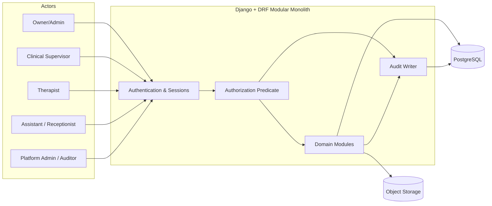

---

## 3. Domain Model

### 3.1 Tenancy, identity, roles, authentication

| Entity | Purpose | Key points |
|---|---|---|
| **Tenant** | A clinic | `slug` unique; `timezone` (IANA, required); status `active/suspended/closed` |
| **User** | Global login identity | No `tenant_id`; unique normalized email |
| **TenantMembership** | User ↔ Tenant link | `roles` set: `owner_admin`, `clinical_supervisor`, `therapist`, `assistant`; one active membership per (tenant, user) |
| **MembershipGrant** | Optional permissions ("if granted") | e.g. `receptionist_operational_access`, `security_metadata_review`; revocable |
| **Session** | Server-side sessions | Immediate revocation on deactivation |
| **ResetToken** | Password reset | Issued/expires/consumed |
| **Invitation** | Join a tenant | Responses never reveal whether an email has an account |
| **PlatformRole** | `platform_admin`, `platform_auditor` | **Grants no clinical access** |

### 3.2 Patients, assignments, supervision

- **Patient** — clinic-scoped. Contact and emergency-contact fields are application-encrypted. Intake data is JSONB with `schema_version`. Normalized name columns support Persian search.
- **ClinicalAssignment** — links a therapist to a patient (`primary`, `co_therapist`, `observing`). Exactly **one active primary** per patient (partial unique index). Insert-only; `ended_at` set once.
- **ClinicalSupervision** — supervisor ↔ specific patient (non-null `patient_id`). Grants clinical access to that patient only.
- **SupervisoryOperationalScope** — supervisor ↔ supervisee, no patient. Grants demographics and appointments only, **never clinical content**.

### 3.3 Full entity-relationship view

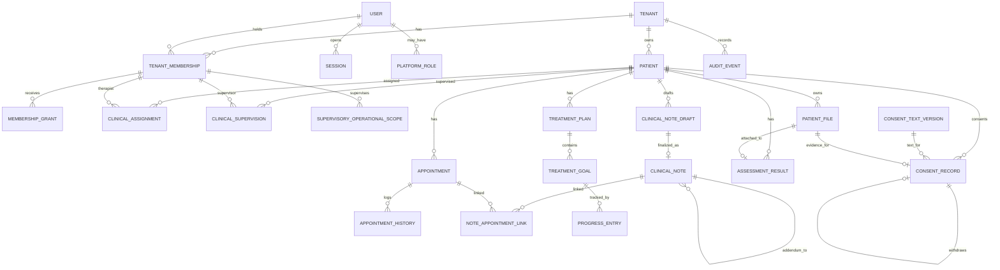

### 3.4 Treatment plans, goals, progress, assessments

- **TreatmentPlan** (`active/completed/archived`) → **TreatmentGoal** (`open/met/abandoned`, target date) → **ProgressEntry** (score, notes, timestamp; goal optional).
- **AssessmentResult** — type, timestamp, JSONB scores, optional attached `PatientFile`.
- All use composite keys so a goal, progress entry, or file can never reference a different patient or tenant.

---

## 4. Authorization Model

### 4.1 The access predicate

Evaluated on **every protected request**, in order. Each term is tested separately; any failure denies the request and writes an audit event with `outcome = denied`.

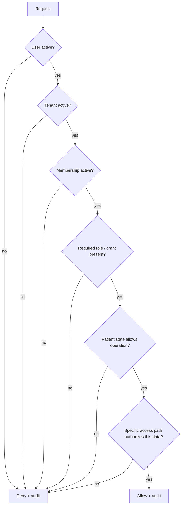

### 4.2 Access paths

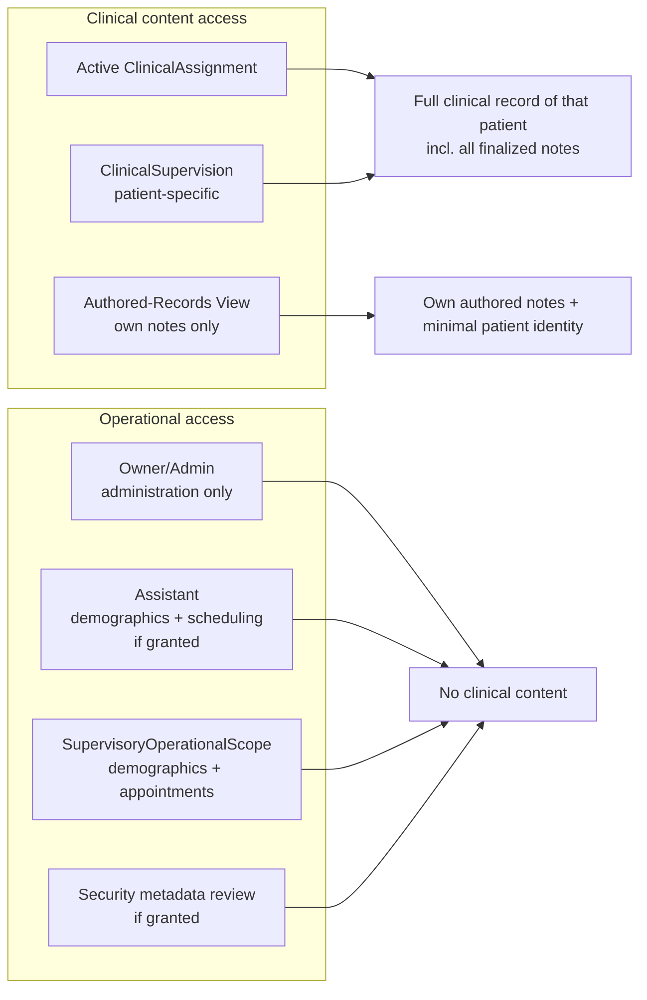

### 4.3 Role capability matrix

| Capability | Owner/Admin | Supervisor | Therapist | Assistant | Platform |
|---|:--:|:--:|:--:|:--:|:--:|
| Tenant administration | ✅ | – | – | – | – |
| Clinical record (assigned patient) | ❌ | via supervision | ✅ | ❌ | ❌ |
| Demographics / scheduling | ✅ | via operational scope | ✅ | ✅ if granted | ❌ |
| Own authored notes (after leaving) | – | – | ✅ authored view | – | – |
| Tenant audit events | metadata if granted | – | – | – | – |
| Platform-scoped audit events | – | – | – | – | ✅ |

### 4.4 Reassignment

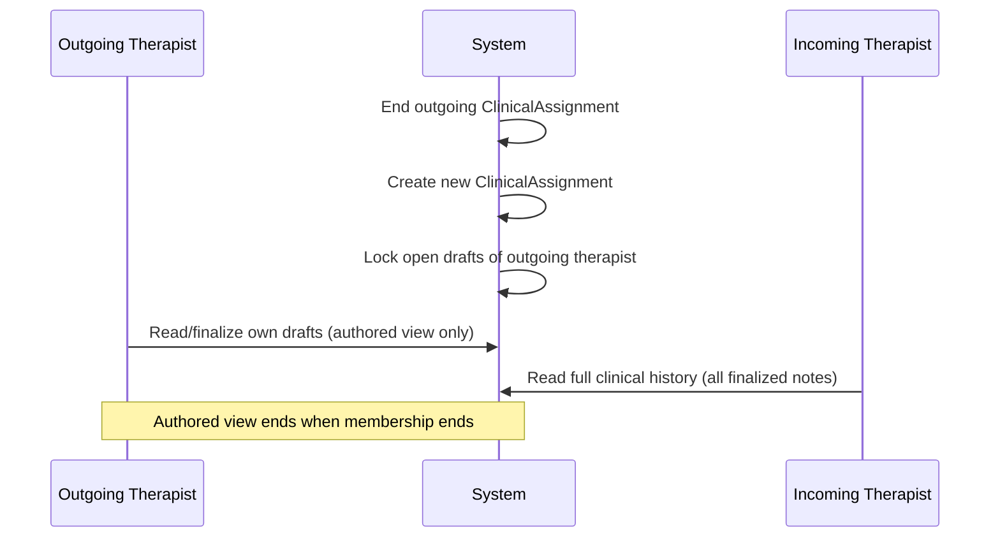

---

## 5. Clinical Notes Lifecycle

### 5.1 State flow

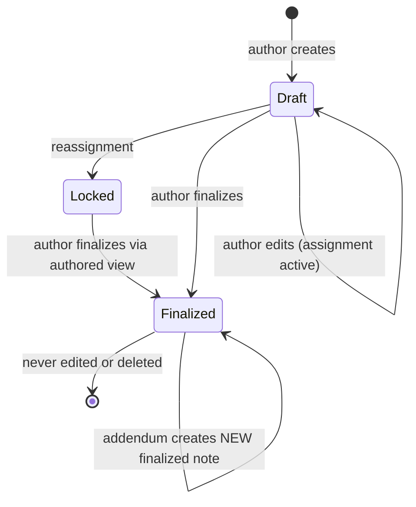

### 5.2 Key rules

- **ClinicalNoteDraft** — editable by the author while the assignment is active. Templates: `soap`, `dap`, `birp`, `free`. Content is JSONB with `template_version`.
- **ClinicalNote** (finalized) — stores `content_hash`, `hash_algorithm`, `hash_canonicalization_version`, and a unique `source_draft_id`.
- **Immutability** is enforced by privileges **and** a trigger: the runtime role cannot `UPDATE`, `DELETE`, or `TRUNCATE`.
- **Addenda** (D7) — a new finalized note with `addendum_to_note_id` and a required, non-empty `addendum_reason`. Check `addendum_to_note_id <> id`. No supersession in MVP.
- **NoteAppointmentLink** — append-only link records (create/remove); neither the note nor the appointment is modified.

### 5.3 Addendum structure

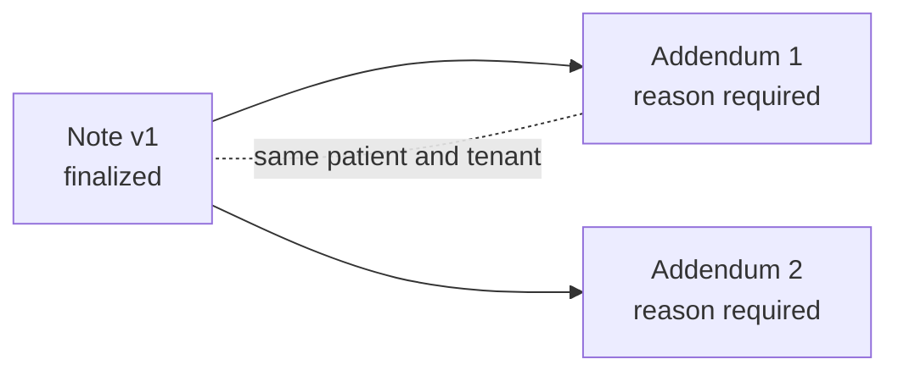

### 5.4 Immutability enforcement layers

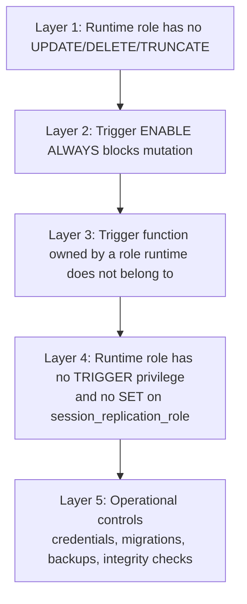

---

## 6. Appointments

**Fields:** UTC start/end (authoritative for conflicts), plus local date/time/timezone preserving the user's entry. Status: `scheduled`, `completed`, `cancelled`, `no_show`.

**Double-booking prevention (PostgreSQL exclusion constraint):**

```
(therapist_membership_id WITH =, tstzrange(starts_at_utc, ends_at_utc) WITH &&)
WHERE status <> 'cancelled'
```

Requires the `btree_gist` extension; availability must be verified at deployment.

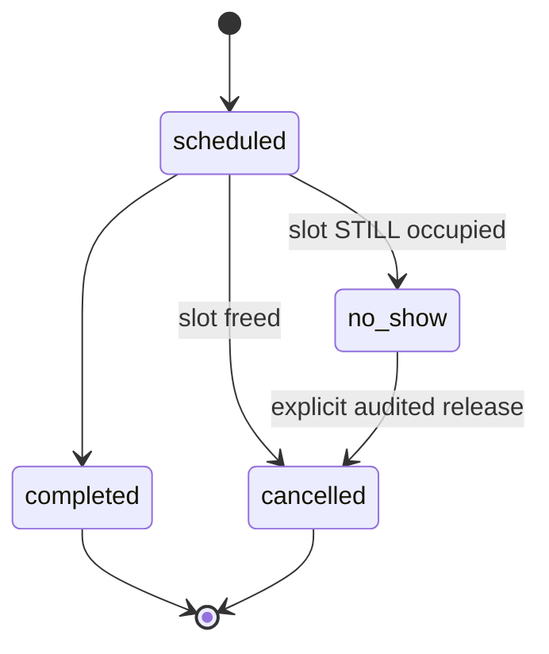

**Design points**
- **D6:** a no-show keeps the slot occupied until an explicit, audited release by the therapist or an administrator.
- A new, unknown status fails safe: it blocks the slot under the negative predicate.
- **D14:** exclusion is per membership. A therapist working in two clinics can be double-booked across them. This is a documented limitation.
- UTC/local consistency is enforced by trigger or application (not `CHECK`, since timezone conversion isn't immutable).
- **AppointmentHistory** is append-only (changed fields, actor, reason, timestamp).

---

## 7. Consent

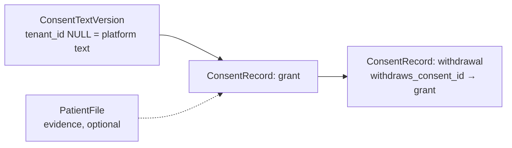

- Records are **append-only**; current state is derived from the latest record in the chain.
- A withdrawal must point to a grant in the same patient/tenant, and a grant can be withdrawn **at most once**.
- **D8:** consent text is tenant-optional. A tenant-scoped version applies only to that tenant; a global (NULL tenant) version applies to any tenant.
- Method: `written`, `verbal`, `electronic`.

---

## 8. Files

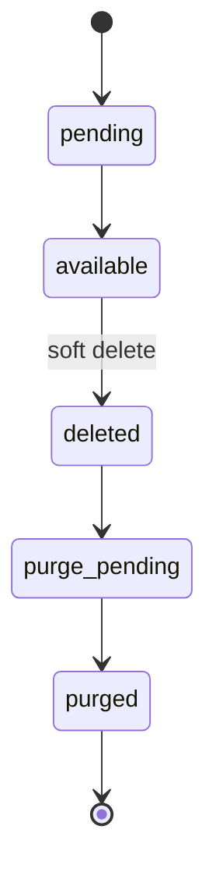

- Authorization is checked against the **PatientFile record on every download**. Knowing a storage key grants nothing.
- `storage_key` is opaque and carries no patient information. `original_filename` may, and is stored accordingly.
- Purge process is not designed yet (depends on D13).

---

## 9. Audit

**AuditEvent** fields: tenant (nullable = platform-scoped), actor type/user/membership, action, resource type/id, outcome (`success/denied/error`), timestamp, correlation ID, and metadata JSONB.

**Metadata must never contain:** clinical content, patient names, free text, credentials, or signed URLs.

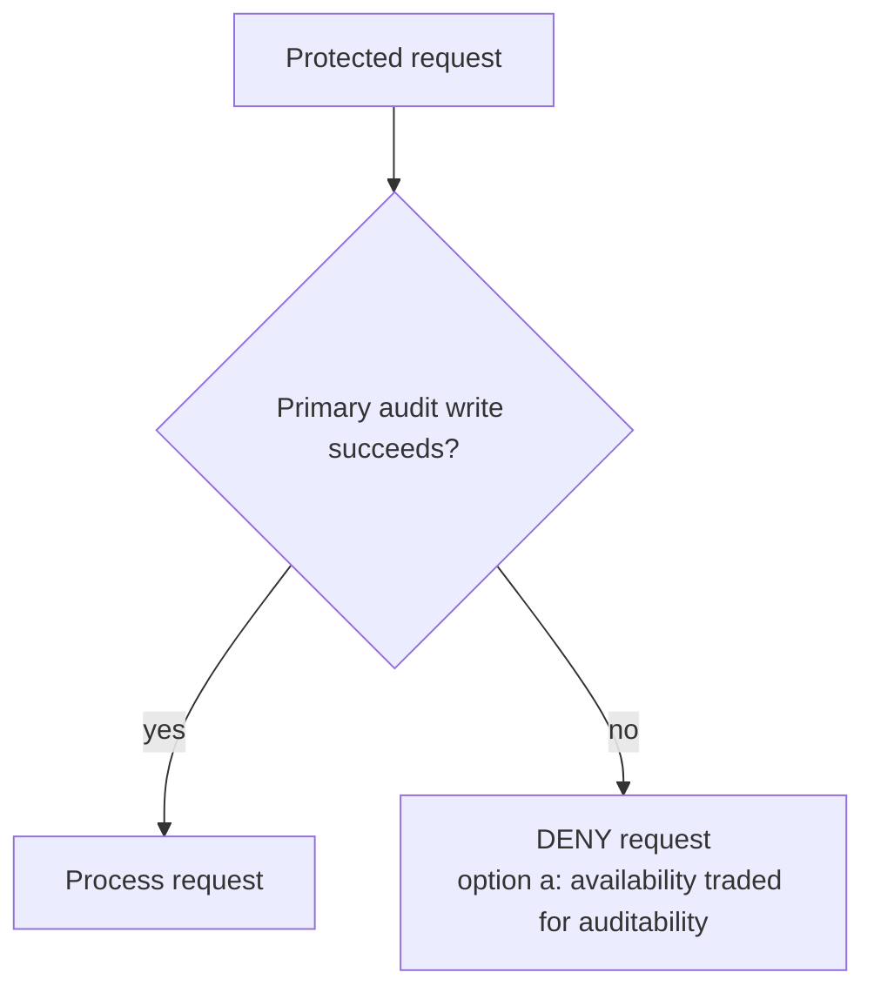

- **Append-only:** the runtime role has no `UPDATE`/`DELETE` on the table.
- Platform events are readable only by platform roles; clinic roles read only their own tenant's events.
- Audit access is itself audited.
- Retention is provisionally **7 years** (revisitable). The table is designed to support partitioning.

---

## 10. Keys, Constraints, Indexes

- All primary keys are **UUID**. Every tenant-owned table has `tenant_id NOT NULL`.
- **Composite foreign keys** prevent cross-tenant and cross-patient references:
  - Patient-scoped: `(parent_id, patient_id, tenant_id)` → unique `(id, patient_id, tenant_id)` on the parent.
  - Tenant-only: `(parent_id, tenant_id)` → unique `(id, tenant_id)`.
  - `MATCH SIMPLE` is safe because `tenant_id` is `NOT NULL`.
- All foreign keys are **RESTRICT**. No cascade deletes for clinical or audit data.
- **Checks:** end ≥ start on memberships/assignments/supervision; appointment end > start; archived ⇒ `archived_at`; note `content_hash` not null; addendum reason required; consent withdrawal rules; enum values.
- **Indexes:** referencing-side index on every composite FK (PostgreSQL does not create them automatically), partial indexes on active rows, normalized name columns, and the appointment exclusion constraint.

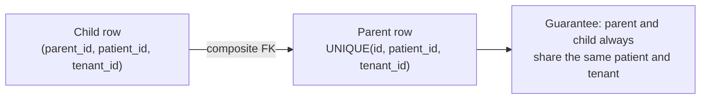

---

## 11. Decision Register (D1–D16)

| ID | Topic | Decision | Residual risk / note |
|---|---|---|---|
| D1 | Patient identity scope | **Clinic-scoped**; no cross-clinic sharing | Duplicates across clinics; merge/dedup out of scope |
| D2 | Incoming therapist access | **All finalized notes** for the patient | Clinical record only, not every data category |
| D3 | Outgoing therapist access | **Authored-records view only**, revoked on membership end | Access audited |
| D4 | Who reads authored view | The **author only**; no supervisor co-authorization | Supervision uses its own relationships |
| D5 | Authored view contents | **Minimum identifying info** (display name, DOB month/year, note metadata) | Dedicated serializer/query path |
| D6 | No-show occupancy | **Keeps slot** until explicit audited release | – |
| D7 | Addenda | Finalized note referencing the original + **required reason** | No supersession in MVP |
| D8 | Consent text scope | **Tenant-optional**; NULL = platform-provided | Cheaper to build now than retrofit |
| D9 | Supervision | **Two relationships** (clinical, operational) | Null `patient_id` not allowed on clinical |
| D10 | Break-glass | **Deferred**; gap documented | Solo practitioner has no in-app emergency path |
| D11 | Audit-write failure | **Deny** access if primary audit write fails | Availability sacrificed; fallback option (b) exists |
| D12 | Privileged-actor risk | **Accepted** with role restrictions + operational controls | Residual risk remains |
| D13 | Erasure vs. immutability | **No erasure of finalized text in MVP** | Needs legal input; manual process |
| D14 | Cross-clinic double-booking | **Per-membership exclusion** | Documented limitation |
| D15 | Hosting / audit retention | **Provisional**: 7-year retention; hosting out of scope | Revisit before production |
| D16 | File deletion | **Soft delete** with lifecycle; purge designed later | Depends on D13 |

### D10 — Break-glass options (deferred)

If later required, the recommended path ("Option D") is: narrow, policy-gated, single-patient, time-limited, reason-required, durably audited, with post-hoc review.

### D11 — Audit failure fallback

Option (b): allow access with an alternate durable audit path, which must be tested and protected. Option (c) is not recommended.

### D12 — Privileged-actor mitigations

The runtime role: does not own protected tables, lacks `TRIGGER`, is not a superuser, and lacks `SET` on `session_replication_role`. The trigger is `ENABLE ALWAYS` and owned by a role the runtime role does not belong to.

---

## 12. Assumptions and Limitations

- **Persian normalization** (email, names, search): not specified in `features.md`; the design assumes Arabic/Persian character and digit folding. The exact rule is a design-time decision.
- **Encryption:** contact fields are application-encrypted; key management is out of scope.
- **Intake form and note templates:** schemas are not specified in `features.md` and are design-time decisions.
- **Timezone rule changes:** the UTC instant is authoritative; local fields preserve the entry; re-interpretation is an application-level decision.
- **Compliance:** hosting location, key management, and Iranian legal requirements are out of scope and need qualified counsel. **No compliance claim is made.**
- **Technical findings** (composite FKs, exclusion constraints, triggers, `btree_gist`) are documentation-verified, not tested.

---

## 13. Known Risks and Remaining Validation Items

| Area | Item | Status |
|---|---|---|
| Legal | Erasure vs. immutability (D13) | Real operational gap; fallback is retention + access restriction + demographic anonymization where lawful |
| Scheduling | Cross-clinic double-booking (D14) | Would need cross-tenant visibility (separate decision) |
| Security | Privileged-actor risk (D12) | Accepted; no external integrity anchor in MVP |
| Operations | Break-glass (D10) | Deferred; solo practitioners have no emergency path |
| i18n | Persian normalization and collation | Must be defined and tested |
| Infra | `btree_gist` availability | Verify on target provider/version |
| Migrations | Composite FK migrations | Need explicit SQL and migration-state discipline |
| Migrations | Trigger-based immutability | Test forward/reverse, fresh setup, upgrades, restores |
| Django | `ForeignObject` + SQL migration for composite FKs | Untested; migration-state test required |
| Security | `session_replication_role` | Design doesn't rely on triggers firing under replica mode; runtime role lacks `SET` |
| Standards | NIST AU-5 | Withheld; no dependency |
| Standards | NIST 800-171 text | Verified via secondary renderings only |
| Legal | Iranian legal/compliance requirements | Unverified; need counsel |
| Infra | Hosting and key management | Undecided |
| Data | Audit retention partitioning | Not designed |
| Files | Purge process | Not designed; depends on D13 |

---

## What This Document Is Not

It is not a schema and not an authorization to implement. Final schema approval and implementation authorization remain with the Operator.
