[← Back to index](../README.md)

# ER diagram

Save the block below as `schema.mmd` and render it with any Mermaid renderer (mermaid.live, the VS Code Mermaid preview, GitHub, GitLab). It shows all 25 entities with relationships and cardinalities. Column-level detail is in the per-table files under [02-tables](../02-tables/README.md).

```mermaid
erDiagram
    Tenant ||--o{ TenantMembership : "has"
    User   ||--o{ TenantMembership : "is member via"
    User   ||--o{ Session          : "authenticates via"
    User   ||--o{ ResetToken       : "recovers via"
    User   ||--o{ PlatformRole     : "platform access"
    Tenant ||--o{ Invitation       : "issues"
    TenantMembership ||--o{ Invitation : "invited by"
    TenantMembership ||--o{ MembershipGrant : "granted"

    Tenant ||--o{ Patient               : "owns"
    Patient ||--o{ ClinicalAssignment   : "assigned through"
    TenantMembership ||--o{ ClinicalAssignment : "therapist or supervisor"
    Patient ||--o{ ClinicalSupervision        : "supervised for"
    TenantMembership ||--o{ ClinicalSupervision : "supervisor / supervisee"
    TenantMembership ||--o{ SupervisoryOperationalScope : "supervisor / supervisee"

    Tenant ||--o{ ConsentTextVersion : "may define"
    Patient ||--o{ ConsentRecord     : "consents"
    ConsentTextVersion ||--o{ ConsentRecord : "governs"
    ConsentRecord ||--o{ ConsentRecord : "withdraws"
    PatientFile   ||--o{ ConsentRecord : "evidence of"

    Patient ||--o{ Appointment : "has"
    TenantMembership ||--o{ Appointment : "therapist"
    Appointment ||--o{ AppointmentHistory : "changes recorded"
    TenantMembership ||--o{ AppointmentHistory : "changed by"

    Patient ||--o{ ClinicalNoteDraft : "has"
    TenantMembership ||--o{ ClinicalNoteDraft : "author"
    Patient ||--o{ ClinicalNote : "has"
    TenantMembership ||--o{ ClinicalNote : "author"
    ClinicalNoteDraft ||--|| ClinicalNote : "finalizes to"
    ClinicalNote ||--o{ ClinicalNote : "addendum to"
    ClinicalNote ||--o{ NoteAppointmentLink : "linked via"
    Appointment ||--o{ NoteAppointmentLink : "linked via"
    TenantMembership ||--o{ NoteAppointmentLink : "created by"

    Patient ||--o{ TreatmentPlan : "has"
    TenantMembership ||--o{ TreatmentPlan : "created by"
    TreatmentPlan ||--o{ TreatmentGoal : "has"
    TreatmentGoal ||--o{ ProgressEntry : "tracked by"
    Patient ||--o{ ProgressEntry : "has"
    TenantMembership ||--o{ ProgressEntry : "recorded by"

    Patient ||--o{ AssessmentResult : "has"
    TenantMembership ||--o{ AssessmentResult : "recorded by"
    PatientFile ||--o{ AssessmentResult : "attached to"

    Patient ||--o{ PatientFile : "has"
    TenantMembership ||--o{ PatientFile : "uploaded by"

    Tenant ||--o{ AuditEvent : "scoped to"
    User   ||--o{ AuditEvent : "actor when user"
    TenantMembership ||--o{ AuditEvent : "actor membership when user"
```

## Reading the notation

- `||--o{` means "exactly one on the left, zero or many on the right". For example, one Tenant has zero or more TenantMemberships.
- `||--||` (ClinicalNoteDraft to ClinicalNote) means one-to-one.
- A self-relationship (`ClinicalNote ||--o{ ClinicalNote`, `ConsentRecord ||--o{ ConsentRecord`) means the table references itself, used for addenda and withdrawals.

## Cardinality rules the diagram cannot show

These live in SQL constraints rather than in the diagram:

- A patient has **exactly one active primary ClinicalAssignment** at a time (partial unique index).
- A ClinicalNote has **exactly one source ClinicalNoteDraft** (unique FK) and **zero or more addendum notes** that reference it (self-FK).
- ConsentRecords form **chains**: each withdrawal has exactly one parent grant, and each grant has at most one withdrawal.
- `AuditEvent.tenant_id` is `NULL` only for platform-scoped events. A CHECK (`ck_ae_tenant_for_clinical_resources`, defined in Part 2, Group I, [AuditEvent](../02-tables/i-audit/audit-event.md)) enforces that any event with a tenant-owned `resource_type` has a tenant.

## Entity pages

Each entity in the diagram has its own page:

- [Tenant](../02-tables/a-tenancy-identity/tenant.md) (`tenant`)
- [User](../02-tables/a-tenancy-identity/app-user.md) (`app_user`)
- [TenantMembership](../02-tables/a-tenancy-identity/tenant-membership.md) (`tenant_membership`)
- [MembershipGrant](../02-tables/a-tenancy-identity/membership-grant.md) (`membership_grant`)
- [Session](../02-tables/a-tenancy-identity/session.md) (`session`)
- [ResetToken](../02-tables/a-tenancy-identity/reset-token.md) (`reset_token`)
- [Invitation](../02-tables/a-tenancy-identity/invitation.md) (`invitation`)
- [PlatformRole](../02-tables/a-tenancy-identity/platform-role.md) (`platform_role`)
- [Patient](../02-tables/b-patients-assignments/patient.md) (`patient`)
- [ClinicalAssignment](../02-tables/b-patients-assignments/clinical-assignment.md) (`clinical_assignment`)
- [ClinicalSupervision](../02-tables/b-patients-assignments/clinical-supervision.md) (`clinical_supervision`)
- [SupervisoryOperationalScope](../02-tables/b-patients-assignments/supervisory-operational-scope.md) (`supervisory_operational_scope`)
- [ConsentTextVersion](../02-tables/c-consent/consent-text-version.md) (`consent_text_version`)
- [ConsentRecord](../02-tables/c-consent/consent-record.md) (`consent_record`)
- [Appointment](../02-tables/d-appointments/appointment.md) (`appointment`)
- [AppointmentHistory](../02-tables/d-appointments/appointment-history.md) (`appointment_history`)
- [ClinicalNoteDraft](../02-tables/e-clinical-notes/clinical-note-draft.md) (`clinical_note_draft`)
- [ClinicalNote](../02-tables/e-clinical-notes/clinical-note.md) (`clinical_note`)
- [NoteAppointmentLink](../02-tables/e-clinical-notes/note-appointment-link.md) (`note_appointment_link`)
- [TreatmentPlan](../02-tables/f-treatment/treatment-plan.md) (`treatment_plan`)
- [TreatmentGoal](../02-tables/f-treatment/treatment-goal.md) (`treatment_goal`)
- [ProgressEntry](../02-tables/f-treatment/progress-entry.md) (`progress_entry`)
- [AssessmentResult](../02-tables/g-assessments/assessment-result.md) (`assessment_result`)
- [PatientFile](../02-tables/h-files/patient-file.md) (`patient_file`)
- [AuditEvent](../02-tables/i-audit/audit-event.md) (`audit_event`)
